# TARS replica

A desk-size replica of **TARS** from *Interstellar*: **four independent columns** like the film robot, joined by
hollow pivots at the top, one **LOLIN S3 Mini** (ESP32-S3) driving two square 1.3" screens and a speaker, two 18650
cells in the legs. Model: OpenSCAD `mechanical/scad/tars4.scad`, fully parametric. Printed on an **Ender 3**.

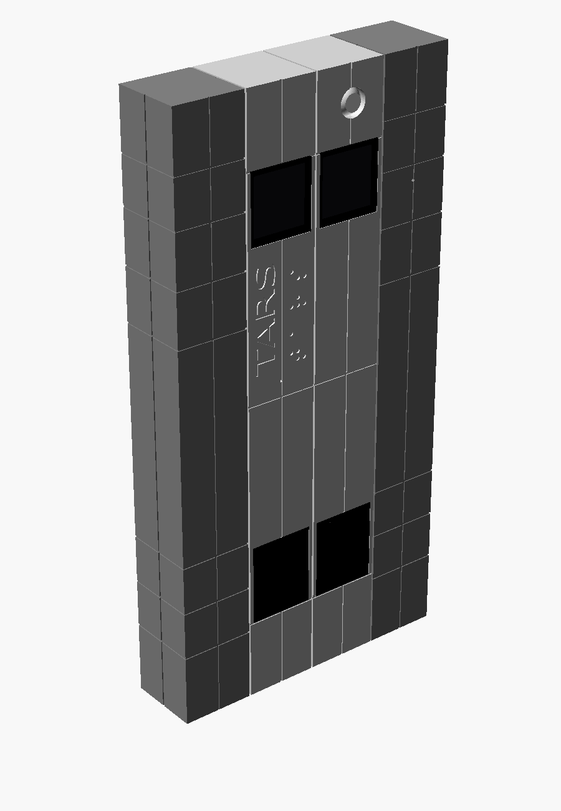 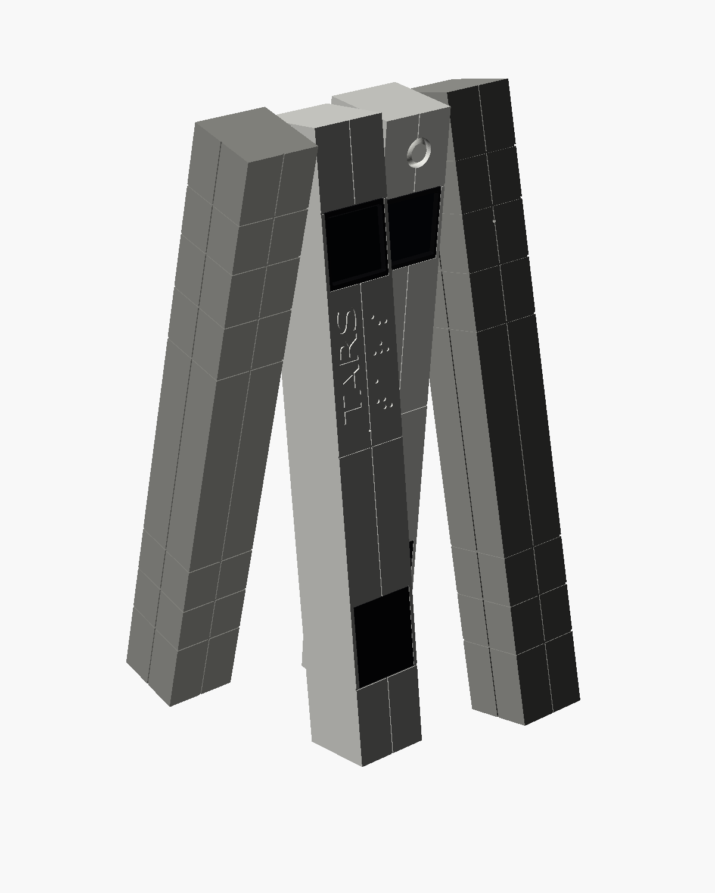

| | |
|---|---|
| Size (W × D × H) | **124 × 31 × 248 mm** (1 : 4 : 8) |
| Brain | 1 × LOLIN S3 Mini (ESP32-S3, 2 MB PSRAM, Wi-Fi, BLE, USB-C) |
| Screens | 2 × 1.3" IPS 240×240 ST7789 with CS (square) |
| Sound | MAX98357A I2S amplifier + 39 × 22 × 10 speaker behind the lower black panel; INMP441 microphone |
| Sensors | ADXL345 accelerometer, AM312 motion sensor, BME280 weather sensor, DS3231 clock, microSD |
| Power | 2 × 18650 in parallel, one protected TP4056 (0.5 A), power path for mains use, TPS63020 3.3 V buck-boost |
| Joints | brass tubes 8 / 7 mm at the top of each joint, wires inside, a detent click every 15° |

Lying face down, lids off (`part="open"`): pivots and screens at the top of the image, cells at the bottom of the legs.
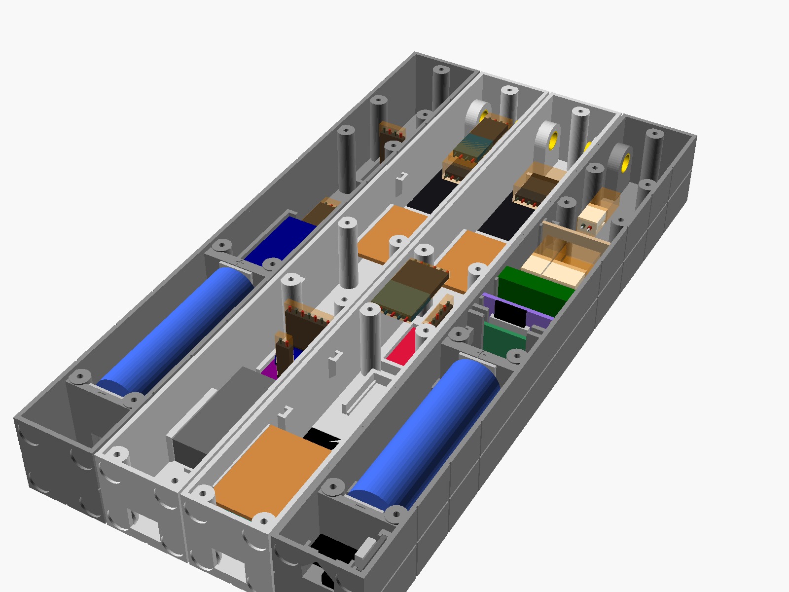 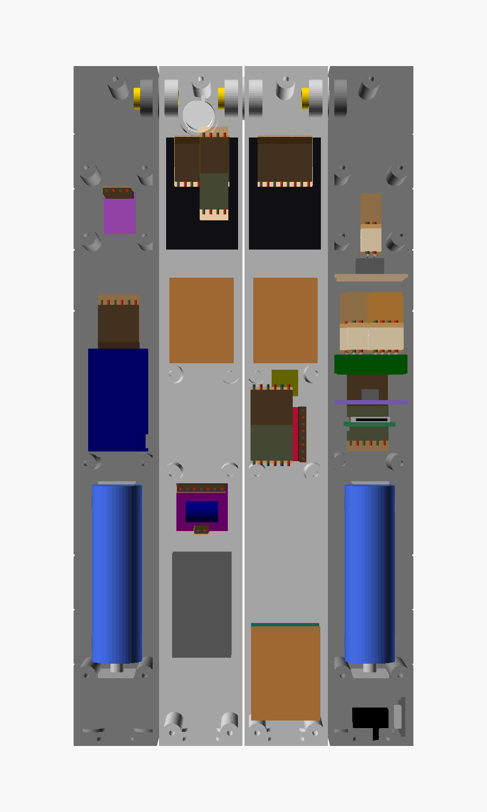

## Folder layout

| Path | Content |
|---|---|
| `mechanical/` | everything printed: `scad/` (model), `stl/` (one file per part), `3mf/` (Orca projects and raw plates) |
| `hardware/` | electronics: `kicad/`, schematic and wiring pages, wiring guide (`tars4_harness.*`), `power_budget.md`, `measurements.md`, `shopping_list.md` |
| `software/` | bench test firmware (`promicro/pir_test`: AM312 on a Pro Micro) |
| `requirements/` | formal requirements (RBD: FUNC / TECH / PERF / UI / CONF / PLAT) |
| `mechanical/scad/tars4.scad` | the model (all parameters at the top; `part` selects what is shown or exported) |
| `mechanical/3mf/tars4.3mf` | **the Orca project** (4 plates arranged by hand, Ender-3 220 × 220): the file to slice |
| `mechanical/3mf/tars4_plate*.3mf` | raw plates from `tools/build4.sh 3mf` (not in git), starting point of `mechanical/3mf/tars4.3mf` (stale as soon as an STL changes) |
| `hardware/tars4_schematic.html` | functional schematic: power path, GPIO map, parts list |
| `hardware/kicad/` | KiCad 10 schematic `tars4.kicad_sch` (+ PDF), generated by `tools/kicad_sch_gen.py` |
| `hardware/tars4_wiring.html` | wiring sketch: back view, lids off, to scale (parts, wires, wires per tube); static copy `renders/tars4_wiring.svg` |
| `hardware/shopping_list.md` | what is left to buy |
| `open_questions.md` | open questions and measurements to make |
| `reviews/` | design reviews (electronics, placement) |
| `mechanical/stl/` | one STL per part, in print orientation (not in git: `make check-stl` before a print) |
| `renders/` | PNG / SVG renders (regenerated by the build scripts and tools) |
| `references/` | film still + zoom, wiki movement diagrams, module drawings and photos |
| `tools/build4.sh` | rebuild STLs, plates and renders (`tools/build4.sh [stl\|3mf\|renders\|all\|cr10]`) |
| `tools/update_orca_project.py` | refreshes the meshes inside `mechanical/3mf/tars4.3mf` from `mechanical/stl/`, keeping plates, positions and settings |
| `tools/stl2_3mf.py` | packs STLs into a multi-object 3MF (`--long-x`, `--angle=DEG`); warns if the layout overflows the bed |
| `tools/tube_section.py` | packs the wires of each pivot tube into its 7 mm bore (`renders/tars4_tube_sections.svg`) |
| `tools/column_sections.py` (+ `mechanical/scad/column_sections.scad`) | side sections of the four columns, every module labelled (`renders/tars4_column_sections.svg`) |
| `tools/wiring_svg.js` | exports the sketch of `hardware/tars4_wiring.html` to `renders/tars4_wiring.svg` (`node tools/wiring_svg.js`) |
| `tools/kicad_sch_gen.py` | generates the KiCad schematic and checks its netlist |
| `tools/boards.py` | hole-by-hole layouts of the hand-wired boards (S3 carrier, P1, P2, power-path board), checked for missing links and shorts → `renders/tars4_board_*.svg` |
| `tools/harness.py` | wiring guide `hardware/tars4_harness.html`: every wire (W1…) with both ends typed (soldered / Dupont / JST-XH, female / male) in build order, one diagram, wire table and bench test per step; reads the board wires and connectors from `boards.py` |
| `Makefile`, `scripts/check.sh` | validation harness: `make check` rebuilds everything and fails on any problem (see *Rebuild*) |
| `mechanical/3mf/tars4_cr10.3mf` | the saved CR-10 Orca project (one-piece parts, one plate), meshes refreshed by `make check` |
| `backups/` | local, git-ignored: copies made by the tools before rewriting a file (history lives in git) |

## Proportions and sizing

The wiki (<https://interstellarfilm.fandom.com/wiki/Robot>) gives **depth : width : height = 1 : 4 : 8**, the top
priority of the design: everything derives from `D` (depth).

- `D = 31` → **124 × 31 × 248 mm**. Columns are `col_w = D − 3·gap/4 = 30.4` wide (4 columns + 3 gaps of 0.8 =
  exactly 4D), walls 1.6 → **27.2 mm inside**.
- What sets D is the screen board (27 mm): it sits in **pockets cut into the side walls** over its height only.
- Other screens in the `SCREENS` catalogue (the model adapts and echoes a note / `WARNING`):

  | `screen` | Screen | Visible area | Min D | TARS size |
  |---|---|---|---|---|
  | `lcd130cs` (default) | generic 1.3" IPS 240×240 ST7789 with CS, board 27 × 42 | **23.4 × 23.4 square** | 31 | 124 × 31 × 248 |
  | `lcd130` | generic 1.3" IPS 240×240 ST7789 without CS (ZJY-IPS130), board 28 × 39 | 23.4 × 23.4 square | 31 | 124 × 31 × 248 |
  | `oled096` | 0.96" SSD1306 OLED 128×64 I2C, board 27 × 27 | 21.7 × 10.9 (2:1) | 30 | 120 × 30 × 240 |
  | `lcd085` | Waveshare 0.85" IPS 128×128 GC9107, board 22.5 × 19 | 15.2 × 15.2 square | 28.5 | 114 × 28.5 × 228 |
  | `lcd169` | Waveshare 1.69" IPS 240×280 | 28 × 32.6 | 36.5 | 146 × 36.5 × 292 |

  Below D ≈ 30 the controller board (25.4 wide) slides in grooves cut in the side walls automatically.
- Frame of reference: x = width (left → right seen from the front), y = depth (0 = front face), z = height (0 = floor).
  Columns 0–3 from TARS's left: col0 left leg, col1 left middle, col2 right middle, col3 right leg.

### Decor (from the film still `references/film_still_tars.jpeg`)

- **Screens** at the top of the middle columns, **lower black panels** near the bottom (z 0.132–0.267·H): both are
  cut **through** the 1.6 mm front wall and filled with **flush black plugs** 1.6 mm thick (0.15 clearance). The screen
  plug carries the bevelled window and is backed by the screen glass; the lower plug rests on a 1 mm ledge inside and on
  the splint at the top. A drop of CA glue on the edges.
- **"TARS"** engraved vertically (reads bottom to top) in the left strip of the left middle column, with **"TARS" in
  braille** in the right strip, as in the film.
- Fine lines (0.8 × 0.4 mm): a vertical groove in the middle of each column, horizontal lines at the top of the screens,
  at mid-height and at the bottom of the lower panels; plate joints on the legs.
- Speaker grille: horizontal slots in the right middle column's lower plug (black on black, barely visible).

## Printing

### Parts (all front face / outer face on the bed, no supports)

| Part | STL | Qty | Length | Notes |
|---|---|---|---|---|
| Left leg, bottom / top | `mechanical/stl/tars4_col0_bottom.stl`, `mechanical/stl/tars4_col0_top.stl` | 1 + 1 | 158.7 / 89.3 | 18650 between spring contacts, micro-USB charge port and switch in the foot, microSD, TPS63020 and TP4056 lying flat (bottom half); power-path board (top half) |
| Right leg, bottom / top | `mechanical/stl/tars4_col3_bottom.stl`, `mechanical/stl/tars4_col3_top.stl` | 1 + 1 | 158.7 / 89.3 | 18650 between spring contacts, DS3231 clock (bottom half), BME280 + vent (top half) |
| Left middle, bottom / top | `mechanical/stl/tars4_col1_bottom.stl`, `mechanical/stl/tars4_col1_top.stl` | 1 + 1 | 66.2 / 181.8 | "TARS" + braille, screen 1, LOLIN S3 Mini on its carrier (USB-C through the floor), spare slot; ADXL345, INMP441, P1 |
| Right middle, bottom / top | `mechanical/stl/tars4_col2_bottom.stl`, `mechanical/stl/tars4_col2_top.stl` | 1 + 1 | 66.2 / 181.8 | screen 2, speaker, MAX98357A, AM312 ring, P2 |
| Leg lid, bottom / top | `mechanical/stl/tars4_lid_leg_bottom.stl` (right leg), `mechanical/stl/tars4_lid_leg_sd_bottom.stl` (left leg: microSD slot), `mechanical/stl/tars4_lid_leg_top.stl` | 1 + 1 + 2 | 196.5 / 47.7 | split at 198.4, above the column seam: the bottom lid bridges it; vents at z 141–149 and 217–230 |
| Middle lid, bottom / top | `mechanical/stl/tars4_lid_mid_bottom.stl`, `mechanical/stl/tars4_lid_mid_top.stl` (right middle), `mechanical/stl/tars4_lid_mid_left_bottom.stl`, `mechanical/stl/tars4_lid_mid_left_top.stl` (left middle, no speaker tabs) | 1 + 1 each | 112.2 / 132.0 | split at 0.46·H; bottom: controller lug, 4 tabs behind the controller, speaker tabs (right only), 45° gussets; top: two continuous screen ribs |
| Splints | `mechanical/stl/tars4_splint.stl` | 1 set of 4 | 20 tall | glued inside across each seam |
| Black plugs | `mechanical/stl/tars4_inserts.stl` (left middle), `mechanical/stl/tars4_inserts_speaker.stl` (right middle, grille) | 1 + 1 set | | screen panel (with window) + lower panel, **black filament** |
| Tube collars | `mechanical/stl/tars4_collar.stl` | 1 set of 3 | | glued on the pivot tubes, PETG |

Overhangs: none needs support (45° slopes, teardrop pads, short bridges ≤ 11.6 mm, 8 mm tube bores): supports off.

### Split for printing (Ender 3)

Orca's Ender-3 bed is **220 × 220**, so **every column and lid is printed in two halves** (longest piece 182 mm).
- Seams sit on lines that already exist: **middle columns** on the top edge of the lower black panel (66.2 mm, covered
  by the plug edge), **legs** on the 0.64·H plate line (158.7 mm). Nothing crosses a seam (lid screws, controller,
  battery bay and pivots are clear of seam ± 10 mm).
- The U **splint** (front + both sides, 1.6 mm = 4 lines, 20 mm tall, printed standing with a 3–4 mm brim) is glued
  inside across the seam (**epoxy**). Lay both halves face down on glass while it sets so the fronts stay flush.
- Lids are split **away from the column seams** (legs at 198.4, middles at 114.1): the bottom lid half is screwed into
  both column halves and bridges the seam at the back, so each seam is held on 4 sides. 0.2 mm gap between lid halves.

### Slicing

**Slice `mechanical/3mf/tars4.3mf`** (Ender-3 0.4, 220 × 220, elephant foot compensation 0.15). After a model change (Orca has no
usable *Reload from disk* here):
1. `tools/build4.sh stl` (new STLs), close the project in Orca;
2. `python3 -I tools/update_orca_project.py mechanical/3mf/tars4.3mf`: replaces each object's mesh by the STL of the same name, keeps
   every plate / position / rotation / setting, adjusts only the height so parts sit on the bed, prints what changed,
   backs up first (`--check` = dry run);
3. reopen `mechanical/3mf/tars4.3mf` in Orca.

The pre-push hook runs step 2 on both projects when the STLs changed (`meshes` stage) and refuses the push until the
rewritten projects are committed: close them in Orca before pushing, or saving from Orca puts the old meshes back.

Raw plates (`tools/build4.sh 3mf`, ~20 mm margins), only to rebuild the Orca project from scratch:

| Plate | Content | Footprint |
|---|---|---|
| `mechanical/3mf/tars4_plate1_columns.3mf` | 2 middle tops, 2 leg tops (end to end), 2 middle bottoms (end to end) | 183 × 138 |
| `mechanical/3mf/tars4_plate2_legs.3mf` | 2 leg bottoms, 4 leg lid halves, 3 tube collars | 197 × 173 |
| `mechanical/3mf/tars4_plate3_lids.3mf` | 4 middle lid halves, 4 splints | 132 × 150 |

Black plugs and the test pieces are separate small prints.

**CR-10 option** (300 × 300): `tools/build4.sh cr10` exports the columns and lids **in one piece**
(`mechanical/stl/tars4_cr10_*.stl`) on one plate `mechanical/3mf/tars4_cr10_plate.3mf` (261 × 248). The Orca project to slice is
`mechanical/3mf/tars4_cr10.3mf`, created once from that layout by `make check` and then only refreshed (Orca's own auto-arrange
pushes the 248 mm columns off the bed: keep the strip layout or arrange by hand). No seams, no splints; the top 10 mm of the
lower black plug then has no ledge behind it: a drop of glue.

### Material

TARS sits on a desk, indoors → **matte grey PLA** for everything visible (closest to the film's brushed aluminium,
crisp fine lines / braille / text, hides layer lines), **matte black PLA** for the panel plugs.
- One grey for all columns (the renders use two shades only for readability).
- **PETG** for the wear parts: the 3 tube collars (and the bearing rings' detent bumps if they wear).
- **Epoxy** rather than CA for the splints (CA gets brittle). Lid screws (straight into PLA) snug, not forced.
- Keep it out of direct sun / away from heaters (PLA softens at ~55–60 °C).
- Smooth PEI or glass → uniform satin front; textured PEI blurs the fine lines.
- Matte PLA has slightly weaker layer adhesion: 1.6 mm walls = 4 lines at 0.4; a few °C more on the nozzle.
- If it ever has to live in a car / sun: all **PETG** + a coat of matte clear spray.

## Screens: 1.3" IPS 240×240 ST7789 with CS (`lcd130cs`)

- 8-pin board **27 × 42**, visible area 23.4 × 23.4 (the film panel at this size is 27.4 × 28.8: a ~2 mm black border,
  close to the film). With a CS pin both screens share one SPI bus, so **one controller drives everything**.
- Fits the 27.2 mm interior (0.1 mm wall pockets); frame z 180.3–225.9 (clipped to the column width), ~6 mm below
  the top pivot. **Glass position and mounting holes not measured yet**: `active_dz = 0` (centred), held by the frame
  → check with the screen test piece (not exported any more: `openscad -D 'part="print_test_screen"' -o test_screen.stl mechanical/scad/tars4.scad`), then update the `lcd130cs` entry in `SCREENS`.
- Two **continuous ribs on the middle lid** (`scr_rib`, 2.6 mm from each side wall, the board's whole height) press
  on its side edges from behind, so the screen cannot tip back, and the wires come down between them (x 5–25).
- Its header is replaced by a **right-angle** one on the back, pins down (`scr_hdr_ra`): X1 / X4 lie flat on the
  screen's back (see *Connectors*).
- `lcd130` (7 pins, no CS, ZJY-IPS130, `references/lcd_1.3_st7789_zjy-ips130.jpg`) is the alternative: it needs one SPI
  host per screen, sits on 4 M2 standoffs (`active_dz = 1.7`, holes 23.2 × 34.1) and its panel hole stops at 216.3.

## Controller: LOLIN S3 Mini (ESP32-S3)

Original **LOLIN S3 Mini** (wemos.cc, 34.3 × 25.4; the model calls it `d1`), ESP32-S3FH4R2: 4 MB flash + **2 MB
PSRAM** (full frame buffers for both screens), SPI with DMA, native I2S, native **USB-C**, BLE. Buttons 0 / RST at the
USB end.
- Vertical in the left middle column, components facing the front, **plugged into a carrier** (`s3_socket`): two
  2 × 8 female headers on a perfboard of the same outline, 6 mm in front of the lid; every wire is soldered on the
  carrier's back, never on the S3 (layout: `renders/tars4_board_s3.svg`, see *Hand-wired boards*). USB-C at the bottom, the board **standing on the bottom lid screw posts**
  (`d1_z0` = 8.1), reachable through an **11.6 × 9 mm** floor opening (most USB-C overmolds are ≤ 11.5 wide). Lay
  TARS down to flash, then OTA.
- Held by strips on the side walls (0.15 play) from 4.5 mm above the bottom (`d1_btn`, clear of the buttons), 2.5 mm
  ribs in front and tabs on the lid behind, in the two pad-free bands (4.5–7 and 27.9–30.4), 2 mm on the RST side where
  the edge is stepped in (`d1_notch`); the lid lug keeps it down. Values from the LOLIN drawing
  (`references/s3_mini_dimensions.png`): check on arrival.
- Carrier wires: a **6–8 cm service loop**; every wire, including those on the edge columns A / J (x 3.8 / 26.6), first
  runs flat inwards (columns C–H) on the solder side before turning up or down, so nothing lies outside x 5–25 in the
  lid-tab bands 4.5–7 and 27.9–30.4; nothing over the S3's top band (antenna). The BOOT button is reached with the S3 pulled out of its socket.
- **The S3's VBUS pin is only its USB-C** (its contact is pulled out of the carrier's female header, so it never reaches
  the carrier, where it would sit between GND and MIC_SD): the PC's 5 V reaches only the S3's LDO, never VSYS
  or the cells → **flash / debug with the switch on or off**.

### Signals (one controller for both screens + sound)

| Function | Signals | Notes |
|---|---|---|
| SPI (shared by both screens) | SCK, MOSI, DC | one SPI host with DMA; SCK split on the carrier (R12 / R19 47 Ω, one wire per screen), MOSI through R20 33 Ω |
| Chip select | CS1, CS2 | |
| Screen reset | RST (shared) | `RST = -1` in the library, one manual reset for both |
| Backlight | BL_EN | GPIO7 → BLK of both screens (PWM ~20 kHz), R4 10 k to GND; low in deep sleep |
| Amp shutdown | AMP_SD | GPIO4 → R10 1 k → MAX98357A SD, R18 10 k to GND (both on P2); low in deep sleep |
| I2S0 → MAX98357A | BCLK, LRC, DIN | through the middle tube, R13 / R14 33 Ω on BCLK / LRC at the S3 |
| I2S1 ← INMP441 | SCK, WS, SD | local (GPIO 14, 38, 15) |
| Charger detect | USB_DET | GPIO21 ← VUSB through R15 68 k / R16 100 k (~3 V when plugged in), C8 100 nF at the S3; wakes the S3 on plug-in |
| I2C | SDA, SCL | ADXL345 (0x53) in the left middle, then BME280 (0x76) and DS3231 (0x68) in the right leg through two tubes; 100 kHz |
| Motion | PIR | GPIO3 ← AM312 OUT through R17 1 k on P2 (active high) |
| Battery | VBAT/2 | GPIO1 (ADC1) ← B+ divider |
| microSD | CLK, CMD, D0 + SD_EN | SDMMC 1-bit, 10 MHz, R11 33 Ω on CLK; SD_EN GPIO36 → Q5 (low = card powered) |

The ESP32-S3 routes SPI and I2S to any GPIO. Avoid the strapping pins (GPIO 0, 45, 46; GPIO3 only selects the JTAG
source when an eFuse is burnt, so it is used as the PIR input) and the USB pins (GPIO 19, 20). GPIO37: planned VSYS sense (small NPN + 1 M / 1 M from VSYS, low = rail present; PLAT-POWER-VSENSE-001, not wired yet). GPIO map:
`hardware/tars4_schematic.html` (confirm when soldered).

- Through the middle tube go **7 wires** for screen 2 (SCK, MOSI, DC, CS2, RST, 3V3, GND from P1) + BL_EN + 3 for I2S +
  AMP_SD, next to B+/B−, the amp's VSYS/GND pair, PIR, SDA and SCL (19 wires, see *Pivots*).
- SPI started at **26.7 MHz** (35 ms per full frame and screen), 40 MHz tried afterwards (ST7789 max ~62 MHz); R12 /
  R19 up to 100 Ω if the image glitches; GPIO12 drive strength lowered; screen 2's SCK next to its GND in the tube,
  away from BCLK.
- **BL_EN** drives only the screens' BLK (not the S3's "EN" pad, which is its reset). The screens have their own
  VCC / GND, so BLK most likely drives an on-board transistor (a few mA): a GPIO is enough. An on-board BLK pull-up only
  lights the backlights at boot (and ~0.66 mA in deep sleep: measure, remove it). Only if BLK feeds the LEDs directly
  (40–60 mA) → AO3401A high-side from 3V3 to BLK, gate pulled up by 10 k, pulled down by an AO3400A / 2N7002 on BL_EN.
- **AMP_SD**: with the breakout's 1 M pull-up to VIN, R18 holds SD < 0.05 V (shutdown below 0.16 V) at boot and in
  deep sleep; driven high, SD > 1.4 V selects the left channel: send the same sample on both. Keep AMP_SD and BL_EN low
  and I2S0 stopped until B+ has been read and validated (with the switch off and the S3 on a PC, a driven amp would be
  back-powered through its pins).
- Libraries: TFT_eSPI or LovyanGFX (ST7789, 240×240, two CS), `ESP_I2S` for the MAX98357A (MP3 decoding fits in the PSRAM).

## Power: two 18650 in parallel (1S2P), one TP4056 in the left leg

**Wiring sketch**: back view, TARS lying face down, lids off, to scale (the left leg is on the right of the drawing).
Interactive version with dark mode: `hardware/tars4_wiring.html`; regenerate the image with `node tools/wiring_svg.js`.

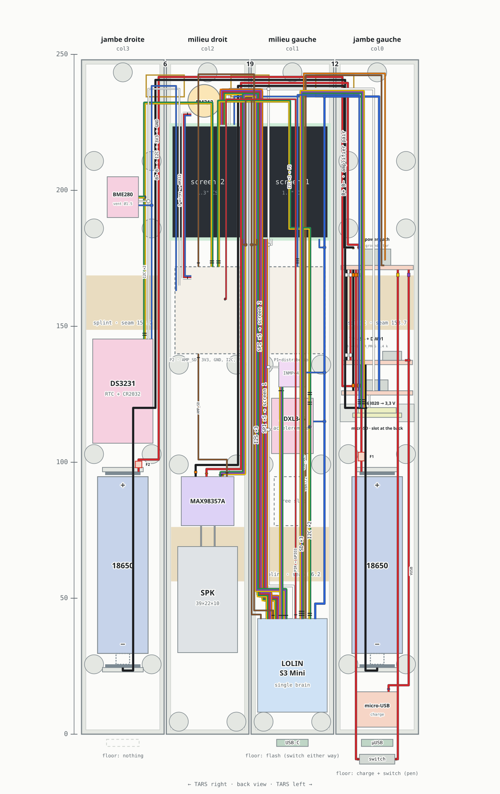

The wires are drawn in the **real colours of the wire kits** (see *Colour code*): thick = 26 AWG power, thin = 30 AWG;
a bus is drawn as its wires side by side, and the bars across a wire near its ends are the heat-shrink rings.

| Wires | Net |
|---|---|
| red / black, 26 AWG | pack B+ / B− (2 × 18650 in parallel, right cell → charger through all 3 tubes) |
| red / black, 26 AWG, **white band** | OUT+ / OUT−: TP4056 → power-path board (Q1, star) |
| red, 26 AWG, **yellow band** | VPATH: power-path board → floor switch |
| red / black, 26 AWG, **orange band** | VSYS / power GND: switch → star → TPS63020; own twisted pair → amplifier VIN |
| red / black, 26 AWG, **purple band** | VUSB / GND: charge port → TP4056 IN+ / IN− and the power-path board |
| white / blue, 26 AWG | 3V3 / logic GND: TPS63020 → left tube → P1 → S3 Mini 3V3 pin |
| white / blue, 30 AWG | 3V3 / GND of the screens (screen 2 through the middle tube) and sensors; microSD 3V3 local |
| grey, 26 AWG | speaker (+ marked with a pen at both ends) |
| yellow green red purple orange | SPI ×5 (SCK, MOSI, DC, CS, RST) to screen 1 (local) and screen 2 (through the middle tube) |
| yellow purple green, 1 ring | I2S0 to the MAX98357A, I2S1 from the INMP441 |
| yellow green, 2 rings | I2C (SCL, SDA) chain to the right leg |
| yellow purple green, 3 rings | microSD CLK, CMD, D0 (+ blue GND, 3 rings) |
| brown · red · orange | BL_EN, VBAT/2, AMP_SD (1 ring) · PIR (1 ring) · USB_DET |
| grey | amplifier → speaker |

The sketch is to scale for the parts; the bus splits are drawn schematically (they physically happen on P1 / P2, see
`hardware/tars4_schematic.html`).

### Cells

- Each **leg** carries one **18650** (Ø18.6 × 65; `bat = [18.5, 50]` for an 18500) standing upright in two U cradles,
  held in by the lid. **Bare cells, removable**, between spring contact plates (never solder on a cell): bottom shelf
  z 22–24.5 → − plate (1.2) + spring (Ø5, 10.7 free, ~4 working, 2.85 solid) → cell 29.7–94.7 → + plate (bump 0.6, 1.8 overall) →
  top shelf 96.5–100.5. Both shelves span the whole interior, merged with the walls and the lid screw posts; wires pass
  through a 13 × 7.9 slot at the front centre. Polarity marks ("+" top, "−" bottom) on the shelves' back faces.
- Plates (13 × 18): solder the wire on the tab first, then slide the plate in from the back **tab first** (the tab ends
  over the slot), wire fed through the slot; a dab of glue holds them while the cell is out. Insert the cell − end
  first, pushing the spring down (solid at 2.85: the cell top clears the + bump by ~0.5 mm), then tilt in.
- The two cells are wired **in parallel** behind **one protected TP4056** (DW01) in the left leg (`power_col = 0`).
  Never two TP4056 in parallel (two chargers and two DW01 fighting).
- **Before the first connection**: same model and age, both cells charged separately to the same voltage (±0.05 V);
  otherwise the higher cell dumps an unlimited current into the other one.
- The right cell's B+ / B− run through **all three pivot tubes** to the charger (26 AWG twisted pair). Each cell's +
  goes through a **1.6 A polyfuse** (F1, F2, XF160 30 V, 15 × 16 × 2.5) near its + plate, standing flat against the
  inner front wall in front of the cell, between the two cradles (z 69–85, two side ribs with feet, a dab of glue; the
  wires run down behind it): the DW01 only guards OUT−, not a B+/B− short in wires that run through turning
  brass tubes; it also trips on a cell inserted backwards.

### Charging

- Charge port at the **heel** of the left leg ([PLAT-MECH-CHARGEPORT-001](requirements/platform.md#plat-mech-chargeport-001)):
  a **micro-USB breakout** standing against the outer side wall of the foot, solder side to the wall, receptacle facing
  backwards through a notch at the bottom of the lid (centre 10.3 above the floor), so TARS charges standing up (or
  stays on mains with a charger plugged in). Its back edge rests against the lid, a front stop takes the plug's push;
  the wires leave forwards. It feeds the TP4056's IN+ / IN− pads; the TP4056's own micro-USB stays unused.

  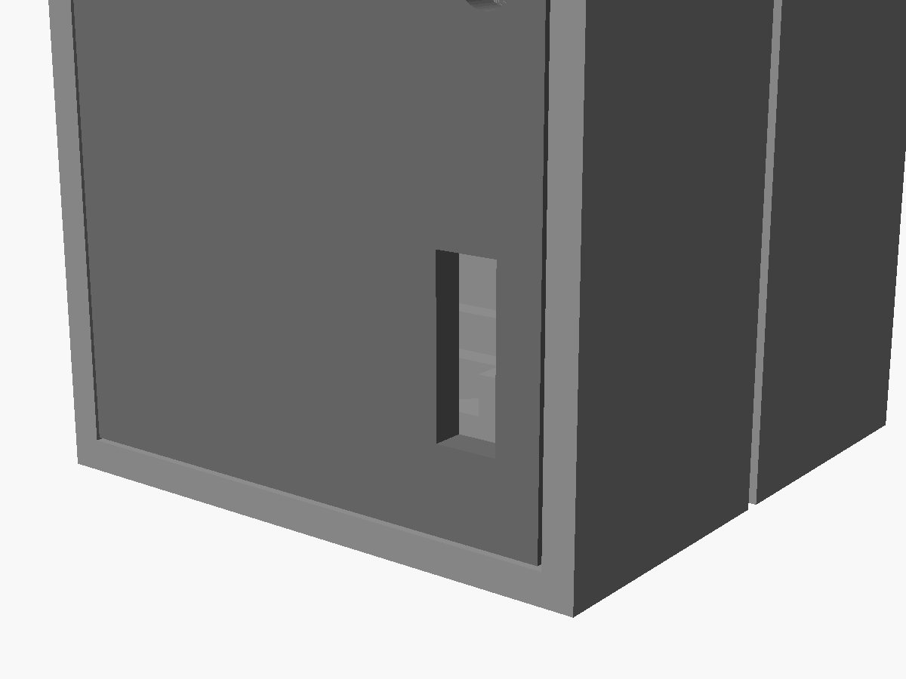 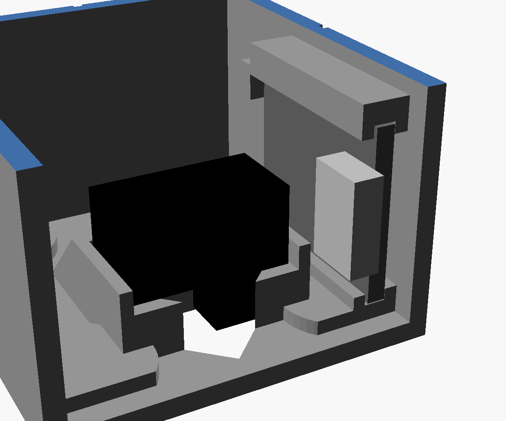

- **Charge current 0.5 A**: swap the module's R_PROG (1.2 k, marked "122") for **2.4 k** ("242"). At 1 A the linear
  TP4056 would burn 1–1.8 W in a closed PLA leg; at 0.5 A (~0.25 A per cell) a full charge takes ~10 h and it still
  dissipates 0.65–1 W: vents in the leg lids, check its temperature after 15 min.
- **D3 (TVS SMAJ5.0A, unidirectional) and C9 (22 µF electrolytic)** sit on the TP4056's IN+ / IN− pads: they damp the
  hot-plug overshoot at the end of ~16 cm of wire from the charge port.
- Use a **5 V ≥ 2 A charger** (0.5 A charge + up to ~1 A for TARS on mains: a PC port is not enough).

### Power path (load sharing)

So that TARS runs **on mains** from a charger in the charge port while the cells charge on their own and terminate
properly (otherwise the TP4056 sees TARS's current as charge current and never ends the charge):

```
TP4056 IN+  (USB 5 V) ──► Schottky D1 1N5822 ───────────┐
                                                        ├──► slide switch ──► VSYS
TP4056 OUT+ (cells)   ──► AO3401A P-MOSFET Q1 (D → S) ──┘
                           gate → IN+, R1 10 kΩ gate → GND
```
- Mains: gate at 5 V → MOSFET off, VSYS ≈ 4.7 V from USB through the Schottky; the cells charge alone.
- Battery: gate pulled to 0 V → MOSFET on (~0.05 V drop), the Schottky blocks.
- The switch sits **after** the merge: off = TARS off, charging still works. **Check its rating** (≥ 1 A wanted: TARS
  peaks at ~1 A with Wi-Fi + amp).
- R1 10 kΩ: when the USB is unplugged the gate falls in ~0.1 s, so VSYS does not sit on the MOSFET's body diode for
  long; the TPS63020 keeps regulating anyway.
- Built on a **26.6 × 20 mm perfboard** (10 × 8 holes, `pp_b` MEASURE, layout `renders/tars4_board_power.svg`) lying flat in the left leg just above the splint (z ≈ 171),
  parts up (`pp_parts` ≤ 6 mm), in side grooves, against the lid side: the wires run in front of it. It carries the
  **star ground**, R2 / R3, R15 / R16 and Q5 / R22. Q1 (SOT-23) is glued **upside down**, oriented as drawn (the drawing
  shows G / S / D seen from above, flipped), and wired with 3 short pieces of **insulated 30 AWG wire-wrap wire**
  (Kynar), so the crossing leads cannot short. Any logic-level P-MOSFET works (DMG2305UX, SI2301); **not** 10 V parts like IRF9520N / IRF9540.

### 3.3 V: TPS63020 buck-boost

- VSYS (cell voltage 4.2 → ~3.3 V, or ~4.7 V on mains) → **U9 TPS63020** (left leg, flat above the microSD) →
  **3.3 V straight into the S3 Mini's 3V3 pin** (26 AWG through the left tube to P1, then the S3, screens, sensors;
  the microSD takes it locally). ~90 % efficient over the whole cell range, good for 1–2 A: no brown-out at Wi-Fi
  peaks, and the **software cut-off is 3.3 V** on B+. It holds 3.3 V down to ~2.5 V in.
- EN tied to VIN (always on after the switch; idle ~25–50 µA), **PS/SYNC to GND** (power save: efficient at light
  load, does not fight the S3's LDO). **Never pull PS/SYNC high** (forced PWM could sink current and push the S3 LDO's
  current back into the cells).
- The S3's ME6211C33 LDO only runs when its USB-C is plugged in; both then feed 3V3, fine in power-save mode. On
  battery a little 3.3 V leaks back through the LDO to VBUS (measure with a cable left in a PC that is off).
- **C1 220 µF at the S3's 3V pin (required)**: Panasonic **POSCAP 10TPE220ML** (polymer tantalum 7343, 10 V, **ESR 25 mΩ**: ~10 mV drop on a
  400 mA Wi-Fi burst), lying flat on the carrier's component side under the S3, + at C2 (the band marks + on an SMD tantalum,
  unlike an electrolytic) (the S3 sits ~35 cm of wire from the TPS).
- The TPS has its own VSYS/GND pair from the star; the logic GND to P1 leaves from its GND pad, along its 3V3 wire.
- **MAX98357A** VIN (2.5–5.5 V) on its own twisted VSYS/GND pair from the star, **C7 470 µF** at VIN: the ~0.5 A amp
  peaks do not share the S3's wires. OUT− = **GND** (not B−: the DW01 MOSFETs sit between them).
- Modelled (`buck`, `bk = [26.7, 17.7, 1.6]` measured, `bk_h`, `bk_lip`): flat in side grooves (lower ledges
  only, a lid tab holds its back edge), z = 124.7, ~10 mm in front of it for the wires.
  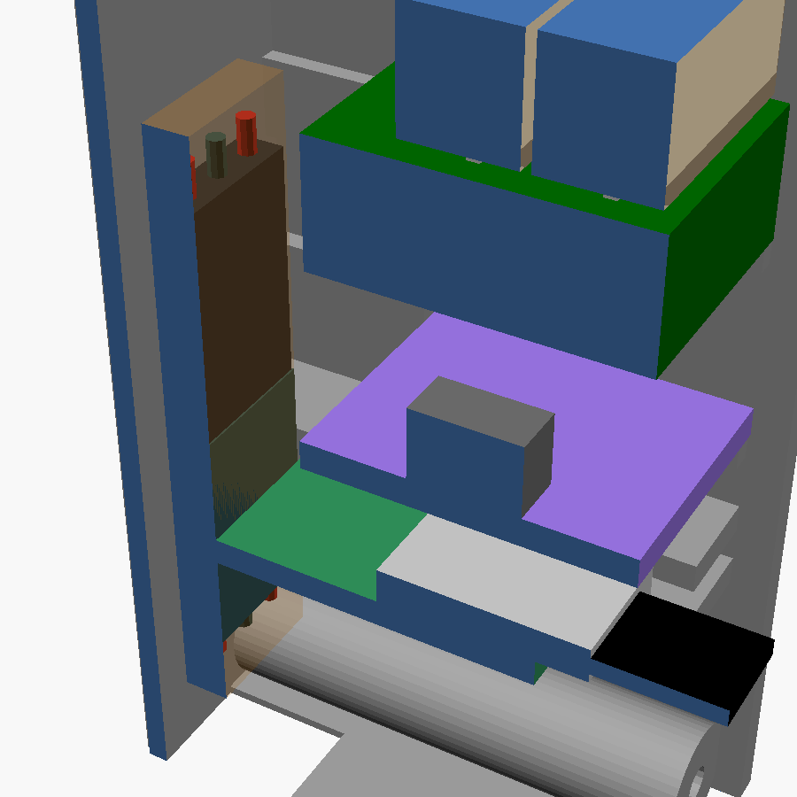

### Battery monitor ("hunger")

- **B+** (TP4056 B+ pad) → R2 / R3 **1 M / 1 M** on the power-path board → one VBAT/2 wire through the left tube →
  GPIO1 (ADC1), C6 100 nF from GPIO1 to GND at the S3.
- On the cells, not on VSYS: on mains VSYS is the USB rail (~4.7 V) and says nothing about the battery. B− needs no
  wire (it differs from GND only by the DW01 switches, < 50 mV). Always connected, hence 1 M / 1 M: ~2 µA standing; C6
  holds the high-impedance node for the ADC (**never a tantalum** there: its leakage shifts the reading).
- While charging (USB_DET high) the reading is 50–100 mV high: show "eating", not a level; after the TP4056 stops, B+
  relaxes from 4.2 V to ~4.15 V ("full").
- Hunger levels, averaged over ~1 min so the amp / Wi-Fi peaks don't make TARS cry wolf: > 3.9 V fed, 3.7 V peckish,
  3.5 V hungry, **3.3 V last words then deep sleep** (unless USB_DET is high). Ignore the cut-off when GPIO1 reads
  < 1.25 V (B+ < 2.5 V: no cells, the S3 runs from a PC's USB).

### Deep sleep and wake-up

- Below the 3.3 V cut-off ~5–10 % is left; standing loads would reach the DW01's 2.4 V in 1–3 weeks unless trimmed:
  remove the status LEDs fed from the battery (ZS-042, TPS63020 module, GY-291, microSD breakout, **the S3 Mini's RGB
  LED on GPIO47**; keep the TP4056 charge LEDs, fed from USB only), clear the DS3231's EN32kHz bit (register 0x0F,
  bit 3), `gpio_hold` CS1 / CS2 / RST / BL_EN / AMP_SD, store an "empty" flag in RTC memory (no wake-up until
  recharged), **cut the microSD's 3V3 with Q5** (set CLK / CMD / D0 as inputs first), clear the ADXL345's INT_SOURCE
  and wait for PIR low before sleeping. Target **~0.35–0.65 mA** with the card powered, less with Q5 off (measure).
- **Wake-up**: everything is active high → EXT1 ANY_HIGH on GPIO2 (ADXL345 INT1), GPIO3 (PIR) and GPIO21 (USB_DET);
  a source already high when going to sleep (USB_DET on mains, PIR still held) is left out of the mask, or the S3 wakes at once; timed wake-ups on the S3's own timer (the DS3231's SQW is not wired).
- The DW01 cuts at ~2.4 V: a last resort, not the normal stop.

### Layout of the legs

- **Left leg, bottom to top**: micro-USB charge port (side wall, 3.1–17.4, receptacle at the heel) and switch in the foot; bottom shelf 22–24.5, cell
  29.7–94.7, top shelf 96.5, F1; microSD 116.5, TPS63020 124.7, TP4056 135.9 (flat, components up, C9 / D3 on its IN
  end); the power block's connectors X10, X12–X14 parked above it (144–166, visible from the back), X16 above the power-path
  board (180–202); splint 148.7–168.7,
  power-path board 170.8; vents in the lid at 141–149 and 217–230. Lid screws at 25.7, 103, 186, 210.8.
- **Right leg**: the same cell bay and F2, DS3231 107–145 (under the splint), BME280 190–205.
- Rough runtime: S3 Mini (~80–120 mA average with Wi-Fi) + 2 screens with backlight on 2 × 2500 mAh → ~20–25 h.

## Sensors, sound, storage

### Sound

TARS talks **through its lower black panel** (right middle column, `speaker_col = 2`):

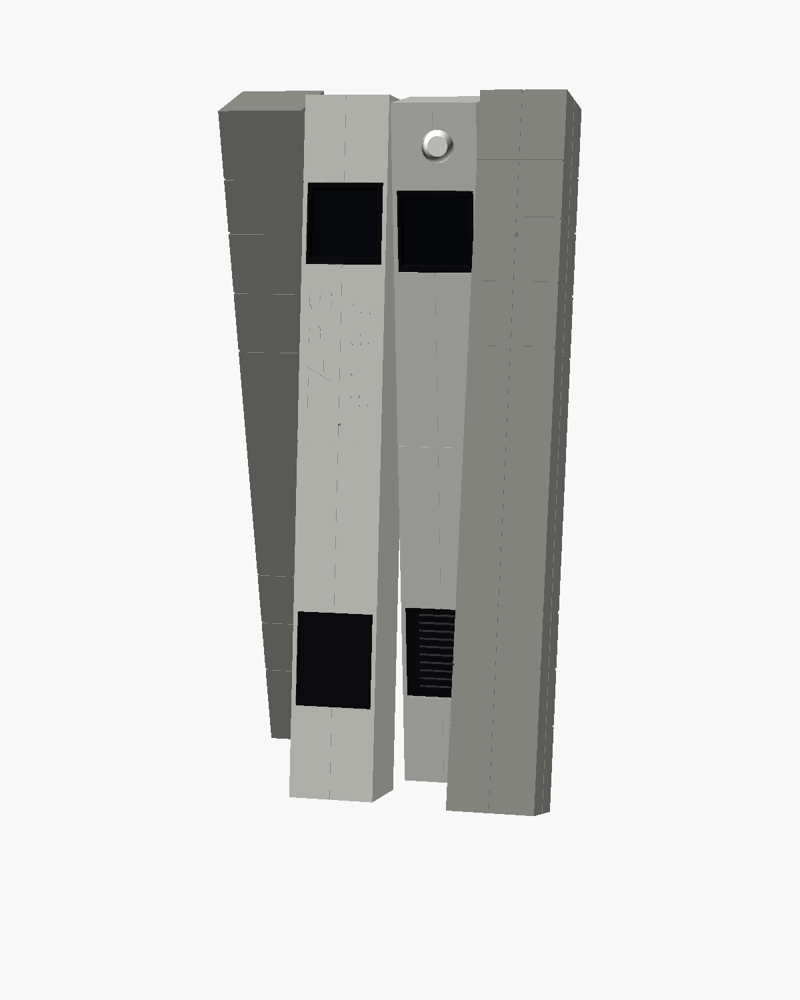

- **Speaker** 39 × 22 × 10 mm facing the front behind the lower panel (z 30–69): held at the front by two stops
  (bottom) and the splint's front plate (top), guided by side rails, pressed forward by two tabs on the right middle lid
  (`lid_mid`; the left one, `lid_mid_left`, has none: they would sit in the S3's wire loop). Insert it after gluing the
  halves (it crosses the seam).
- **Grille**: horizontal slots (1.2 mm every 3 mm) in that column's black plug → `mechanical/stl/tars4_inserts_speaker.stl`.
- **Amplifier** MAX98357A (~19.4 × 18) in a slot on the inner front wall just above the splint (z 76.7–94.7). I2S0
  BCLK / LRC / DIN, VIN / GND on their own pair, C7 470 µF (Ø8 × 12) soldered on VIN / GND and lying across behind the
  board, between X6 and X5 (`c7`). GAIN default (9 dB); SD on AMP_SD (see *Signals*).
- **Microphone** INMP441 (10 × 10, castellated) in the left middle column between the upper screw posts, just under
  P1, far from the speaker: top-port MEMS, **chip side against the wall**, the sound hole facing a Ø1 hole in the
  vertical decor groove (invisible). Seal with a ring of foam tape, never glue on it. Own I2S1 (GPIO 14, 38, 15, local
  wires), L/R to GND.

### Motion sensor: AM312

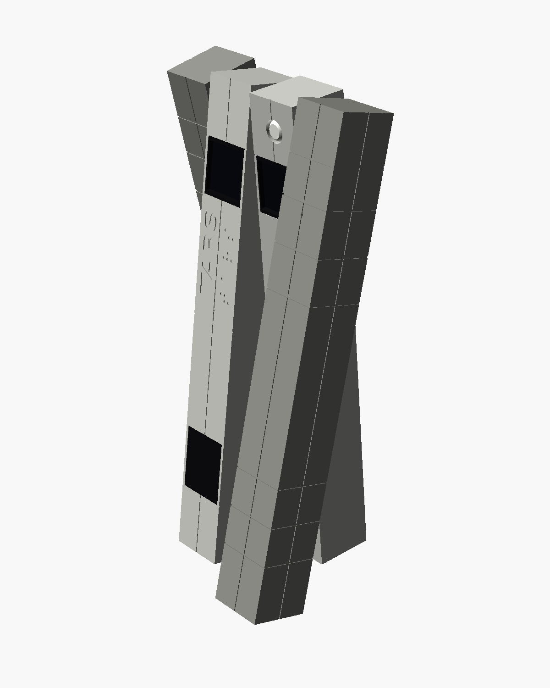

- **AM312** mini PIR (2.7–12 V, ~15 µA, push-pull output held ~2 s, active high) at the **top of the right middle
  column**, z ≈ 233, in the 14 mm band between the screen frame and the top lid screw (`pir_z = undef`; a value puts
  it between the middle screw rows instead).
- **Off the column axis**: at that height the middle tube ends on the left (collar + tube end, x ≤ 9.1) and the right
  tube's glued boss starts on the right (x 23.8); the sensor is centred between the two, `pir_x` = 16.45, **1.25 mm
  right of the axis**, 2.1 mm clear on each side.
- The bare detector (Ø8.15 TO-5 can) is soldered on the edge of a 10.25 × 8.10 breakout standing perpendicular to the
  front wall, flush with one end of that edge (`pir_pcb_a` = 90: the board runs up from the can, 6.2 mm above its
  axis; `pir_pcb_dn` its offset from the axis, estimated). The Fresnel cap goes in **from the inside**, dome
  first, until the dome meets the edge of the **Ø11.5 wall hole** (`pir_hole`, over the vertical decor groove): its
  top sits **flush with the front face**. A Ø14.8 ring on the inner wall (to 6.7 mm behind the face) centres the
  Ø12 rim; glue it there. The can slides into the skirt from the inside, the breakout spans 9.8–17.9 mm behind the
  face (`pir_cap_*`, `pir_dome_*`, `pir_can_*`, `pir_pcb`). Chosen on the trial plate `pir_test` (2026-10-24, tested
  with a Pro Micro): the holes print ~0.6 mm small (Ø10.8 / 10.5 / 11 / 11.5 drawn → 10.3 / 10.0 / 10.5 / 10.8),
  the dome never sticks out, and the largest hole (flush dome) detects well; the outside-cap hole came out too
  small for the Ø10.5 skirt. Breakout pins trimmed flush and the breakout sleeved in heat-shrink: the middle tube's wires exit 5 mm from it and turn down along the left wall right after the tube end.
- OUT → **R17 1 k on P2** → PIR wire through the middle tube → **GPIO3**; wakes the S3 with the ADXL345 INT1 and
  USB_DET. 3V3 / GND from P2 through an RC filter (**R21 100 Ω + C12 10 µF tantalum 16 V**, fc 160 Hz, ~40 dB at 20 kHz: the backlight PWM chops screen 2's
  current on the shared 3V3 wire), P2 decoupled by **C10 10 µF + C11 100 nF**.
- Uses: wake up when someone comes near, lock the PC (BLE keyboard) when they leave.

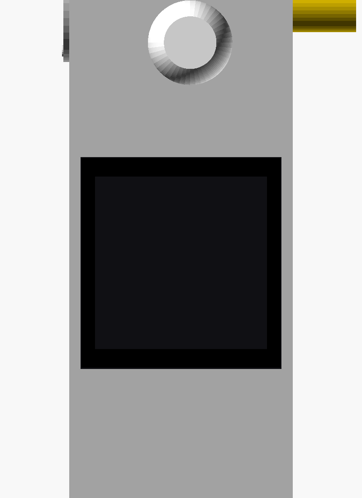 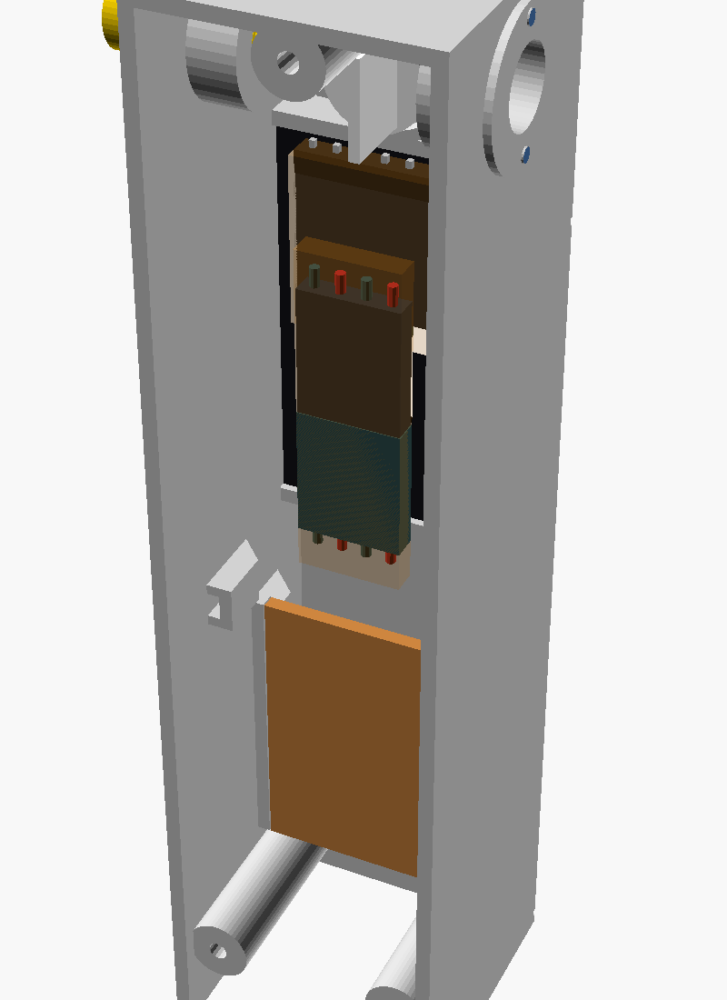

### Accelerometer, weather, clock

- **ADXL345** (GY-291) on the inner front wall of the left middle column just above the 99 mm screw row, stood off the
  wall by 1.2 mm (`pcb_gap`: cut pins and pads on that side). I2C mode: **CS → 3V3**, **SDO → GND** (0x53), bridged
  on the board; INT1 → GPIO2 for tap / motion wake-up.
- **BME280** (purple GY-BME280, 3.3 V, no regulator: check) in the **right leg** above its third screw row
  (z ≈ 190–205), the coolest place (far from the S3, the TPS63020 and the charger): board in a slot on the inner front
  wall, sensor side against the wall, facing a Ø1.5 vent (`bme_b`, `bme_port_dz` MEASURE). Read it right after waking
  up and calibrate an offset. Uses: weather trend from the pressure, comments on the room's humidity.
- **DS3231** RTC (ZS-042, CR2032) in the **right leg** above the top cell shelf (z ≈ 107–145), CR2032 holder against
  the wall, its 6-pin right-angle header kept and pointing **up** through a notch in the slot's top stop (X8). With a
  non-rechargeable CR2032, remove its charging resistor ("201", next to the 6-pin header, or the diode beside it). SQW
  not wired.
- I2C chained S3 → ADXL345 → middle tube → P2 → right tube → BME280 → DS3231; 3V3 / GND chained P1 → microphone →
  ADXL345 and P2 → right leg. The boards' pull-ups in parallel (~1.6–2.4 k): **100 kHz** with the glitch filter on;
  twist SDA with GND and SCL with 3V3 in the right tube (~1 m of bus next to SCK / BCLK).

### microSD

- 3.3 V-only breakout (no regulator, ≤ 25 × 25 with the socket at an edge) in the **left leg** above the top cell shelf
  (z 116.5, below the TPS63020), lying flat in side grooves with the socket mouth facing the lid; card inserted through
  a **12.5 × 2.2 slot in the left leg lid** (`lid_leg_sd`, push-push). The latched card
  sticks out of the lid face (5 mm, see below): pulled by hand.
- SDMMC 1-bit (CLK, CMD, D0; 10 k pull-ups R5–R9 on CMD, D0–D3 to its switched 3V3 if the reader has none), 3V3 from
  the TPS63020 next to it, **switched by Q5** AO3401A on the power-path board (SD_EN on GPIO36, low = on, R22 100 k gate
  pull-up keeps it off while the pin floats), a **dedicated GND** from P1 twisted with CLK through the left tube; R11
  33 Ω on CLK at the S3, C4 10 µF + C5 100 nF at the reader (hot insertion), **10 MHz**. Files can also be copied as
  USB mass storage through the S3's USB-C.
- Board measured 18.2 × 18.2 × 1.5 (`sd`), centred socket 14 × 11.5 × 2 overhanging the back edge by 2.8 (21 overall);
  latched card 6.9 beyond the socket mouth; the board sits **2 mm forward** (`sd_fwd` = 2): the card ends **3 mm proud of
  the lid**, 4.5 mm left in front of the board; still `MEASURE`: `sd_lip`. The 48 × 31 module in stock does not fit.
  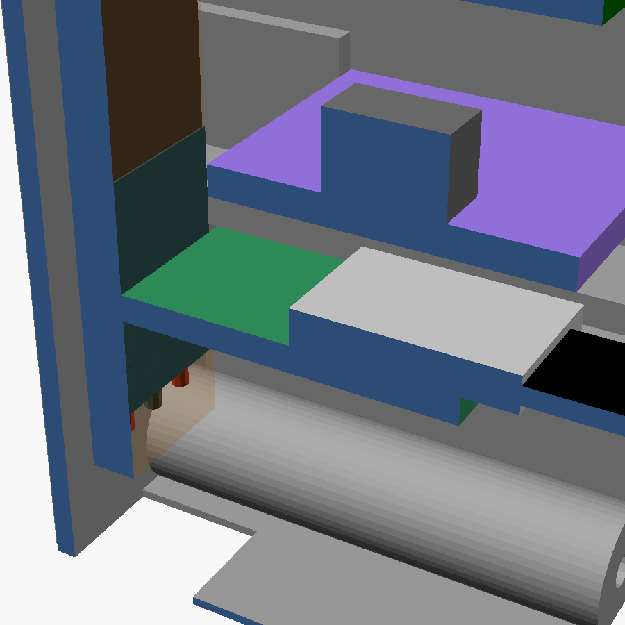

### Spare slot

`bb`, 13.4 × 18 on the inner front wall of the left middle column just above the splint (z 76.7–94.7), the same slot
as the amplifier on the other side: free.

## Pivots and wiring

- **One pivot per joint, at the top** (238.4 mm, as high as the bosses allow so it clears the screen board): the
  two-legged walk. The wires run through the tubes, so there is no centre pivot (no crutch walk / wheel).
- Tube: **brass 8 / 7 mm** (`tube_od = 7.93` measured), ~20 mm long per joint. Glued into the left-hand column of the
  joint (teardrop hole 8.00), turning in the right-hand one (teardrop hole 8.05, PLAT-MECH-PIVOT-001) on a Ø16 bearing ring with 2 detent bumps; 24 dimples on the fixed side
  → a click every 15°. A printed collar (Ø13 × 2, `collar`) glued on the tube inside the turning column holds the joint
  together; the tube sticks out 0.5 past it (`tube_over`). Bosses Ø14 × 5 inside the walls; nothing else at that height.
- Swinging back and forth is fine; endless rotation would need a Ø12.5 slip ring.

### Wires per tube

From the left leg (front view), silicone wire, **30 AWG (Ø0.8) for every signal and for the screens' / sensors'
3V3 / GND** (≤ 80 mA, < 20 mV drop), **26 AWG (Ø1.5) for the power wires** (B+, B−, amp VSYS/GND, 3V3 and GND to P1):

| Tube | Wires | Fill of the Ø7 bore |
|---|---|---|
| left (col0 ↔ col1) | **13**: B+/B−, VBAT/2, USB_DET, SD_EN, logic GND and 3V3 to P1, amp VSYS/GND, microSD CLK, CMD, D0, GND | ~37 % |
| middle (col1 ↔ col2) | **19**: B+/B−, amp VSYS/GND, screen 2 (SCK, MOSI, DC, RST, CS2, 3V3, GND), BL_EN, AMP_SD, I2S ×3, PIR, SDA, SCL | ~38 % |
| right (col2 ↔ col3) | **6**: B+/B− of the right cell, SDA, SCL, 3V3, GND | ~14 % |

With 28 AWG signals the middle tube would be ~60 % full (very hard to pull and to keep turning).

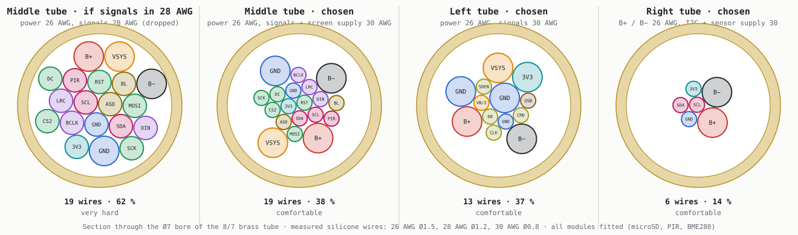

- The middle tube carries two GNDs on purpose: the amp's (twisted with its VSYS, straight back to the star) and
  screen 2's logic GND (from P1), so the amp's current pulses never flow in the logic ground.
- **Twisted pairs**: B+/B−, the amp's VSYS/GND, microSD CLK/GND. 26 AWG drops < 0.1 V on the power runs.
- Deburr the tube ends, strain relief (heat-shrink / hot glue) at the solder joints, a short heat-shrink sleeve on the
  bundle where it leaves each tube. Thread bare wires, crimp / solder after.
- **Tie anchors** (`ties`, `TIES`): 15 printed bridges on the side walls for a 2.5 mm cable tie (left leg 112 / 179 /
  218, left middle 50 / 80 / 128 on both walls, right middle 106 / 178 on both walls, right leg 111 / 179), clear of
  the screw posts and splints and ≥ 20 mm below the tube axis. In the screen band the two lid ribs channel the bundle.

### Colour code

**Power goes in pairs** (since 2026-10-27): **red / black** for the battery and 5 V side (B+/B−, VUSB, VPATH, VSYS
and their GND), **white / blue** for the regulated 3V3 and its logic GND, in 26 AWG and in 30 AWG alike. **Blue is
power only** (regulated GND), never a signal; never yellow for 3V3. Signals: one colour per *role* (30 AWG, 10-colour
kit, black and grey unused in 30 AWG), the same on every segment of a signal; heat-shrink rings at both ends tell the
buses apart: no ring = screens / sense lines, **1 ring = I2S (amp and mic) and PIR**, **2 rings = I2C**, **3 rings =
microSD**. **Power rails sharing the red / black pair get one coloured band** instead (10 mm of coloured heat-shrink,
shrunk 2–3 cm from each end, the same on the + wire and on its GND; slide it on before soldering / crimping): none =
B+ / B− of the cells, **white** = OUT+ / OUT− of the TP4056 (protected side: never swap it with B−), **yellow** =
VPATH, **orange** = VSYS (star, TPS63020 input, amp pair), **purple** = VUSB. The white / blue 3V3 pairs need no band.
Every combination is unique inside each tube: the two red / black 26 AWG pairs of the left and middle tubes are the
right cell's B+ / B− (no band) and the amp's VSYS / GND (orange band). Label both ends anyway (27 wires meet at the
S3's carrier). Coloured mini cable ties can replace the ring count at the ends, but **no tie within 25–30 mm of a tube end**
and only loose ones on the 30 AWG.

| Colour | Signals (rings) | Length (30 AWG, cut lengths from `hardware/tars4_harness.pdf`) |
|---|---|---|
| white | 3V3 of the screens and sensors (VCC is white, as in industry) | 2.2 m |
| blue | GND of the screens and sensors (pair of the white 3V3) · SD GND (3) | 2.2 m |
| yellow (clocks) | SCK · BCLK, MIC_BCLK (1) · SCL (2) · SD_CLK (3) | 3.6 m |
| green (data) | MOSI · DIN, MIC_SD (1) · SDA (2) · SD_D0 (3) | 3.5 m |
| purple (select / frame) | CS1, CS2 · LRC, MIC_WS (1) · SD_CMD (3) | 2.5 m |
| red (status) | DC, INT1 · PIR, PIR OUT (1) | 2.0 m |
| orange | RST, USB_DET | 1.5 m |
| brown | BL_EN, VBAT/2 · AMP_SD (1) · SD_EN (3) | 2.8 m |

Middle tube: SCK yellow, MOSI green, CS2 purple, DC red, RST orange, BL_EN brown, BCLK / LRC / DIN yellow / purple /
green with 1 ring, AMP_SD brown 1 ring, PIR red 1 ring, SDA / SCL green / yellow 2 rings, 3V3 / GND white / blue. Left
tube: VBAT/2 brown, USB_DET orange, SD_EN brown 3 rings, SD_CLK / CMD / D0 yellow / purple / green 3 rings, SD GND blue
3 rings. Power (26 AWG): red B+ / black B− (cells, no band), red / black with a white band (OUT+ / OUT−), yellow
(VPATH), orange (VSYS: star, TPS63020 input, amp pair) or purple band (VUSB), white 3V3 / blue logic GND (TPS63020 → P1
→ S3), grey speaker.

### Distribution boards P1 / P2

Two stripboards 24 × 32 (9 × 12 holes, strips across) standing below the screens (z 139.9) in the middle columns,
where the buses split (layouts: `renders/tars4_board_p1.svg`, `renders/tars4_board_p2.svg`):
- **P1** (left middle): GND (two strips), 3V3, BL_EN (R4 10 k to GND), DC, RST, MOSI; C2 10 µF + C3 100 nF.
- **P2** (right middle): AMP_SD_S3 | AMP_SD (R10 1 k across a strip cut, R18 10 k), GND, 3V3, SDA, SCL, PIR_VDD
  (R21 + C12), GND, PIR | PIR_OUT (R17 1 k across a strip cut); C10 / C11. The S3's wire lands before the resistor
  (A11, A4), the module's after it (F11, F4).

### Hand-wired boards

Names: **P1–P4** are the hand-wired boards, **X1–X16** the connectors only, the modules keep their own names.

**Where to start**: `hardware/tars4_harness.html` and its printable copy `hardware/tars4_harness.pdf` (A4: each step's instructions on one page, its
diagram on its own page(s), in portrait or landscape, split by tube when the text would print under 7 pt; `python3 -I tools/harness.py`, the PDF through headless Firefox with `tools/html2pdf.py`) list all 110 wires in 7 bench-tested
steps (power block, charge port / switch / cells, S3 carrier, P1 and the left middle, left tube, middle tube and the
right middle, right tube and the right leg), each wire with both ends: grey dot = soldered, blue D = Dupont, orange
XH = JST-XH, F / M = female / male contact; block frames: green = board P, purple = module, blue = Dupont side,
orange = JST-XH side. The board drawings below use the same end code.

Four boards carry the harness; each has a hole-by-hole build drawing generated by `python3 -I tools/boards.py`, which
first checks the description: every net connected, no two nets touching, no lead under another part, on the pad
boards no power net (VUSB, VPATH, VSYS, OUT+, B+) next to any other net (GND, GPIO, 3V3 or another power net), and
every part on the same nets, under the same names, as in the KiCad schematic (`tools/kicad_sch_gen.py`).
All boards are **single-sided** (copper on one face only): parts on the bare face, every joint on the copper face. Each drawing shows the component side and
the solder side (mirrored), the strip cuts, solder bridges, bare buses and insulated jumpers, every harness wire
numbered in its kit colour with its heat-shrink rings, the **connectors** its wires are crimped into (harness side,
pin 1 on the left, every contact in order: this board's wire number in its colour, plugged keying cavities in grey,
the other contacts with their signal) and the tables of parts, links and wires (hole → destination → connector pin).
`boards.py` also checks that each wire's signal is the signal of the contact it is crimped into (`CONNS`).

| Board | Size, holes | Drawing |
|---|---|---|
| **P3** S3 carrier (left middle, z 8–43) | 25.6 × 34.4 pad board, 10 × 13 | `renders/tars4_board_s3.svg` |
| **P1** (left middle, below screen 1) | 24 × 32 stripboard, 9 × 12 | `renders/tars4_board_p1.svg` |
| **P2** (right middle, below screen 2) | 24 × 32 stripboard, 9 × 12 | `renders/tars4_board_p2.svg` |
| **P4** power-path board (left leg, z 170.8) | 26.6 × 20 pad board, 10 × 8 | `renders/tars4_board_power.svg` |

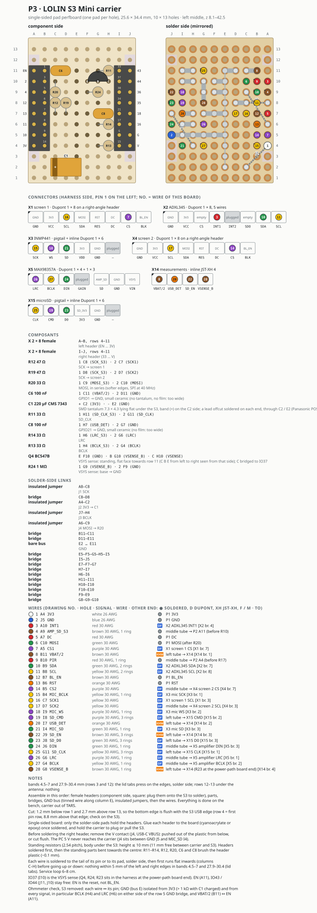
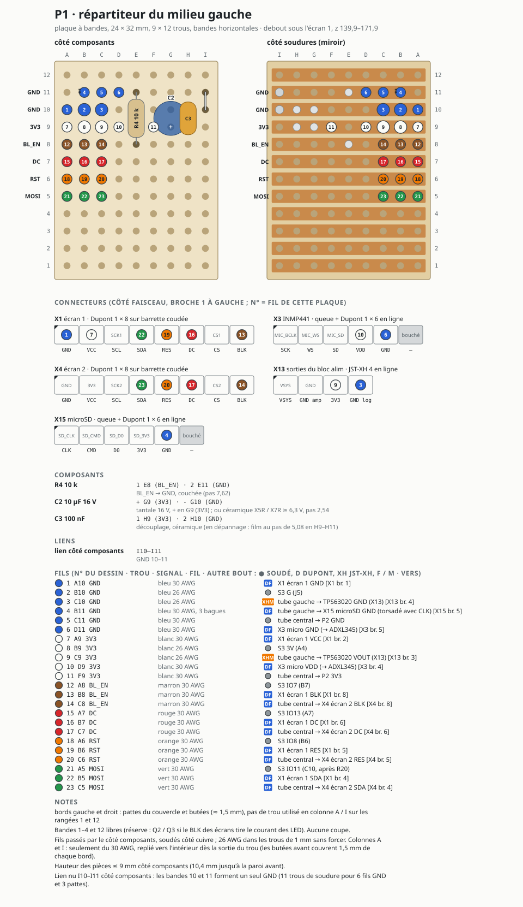 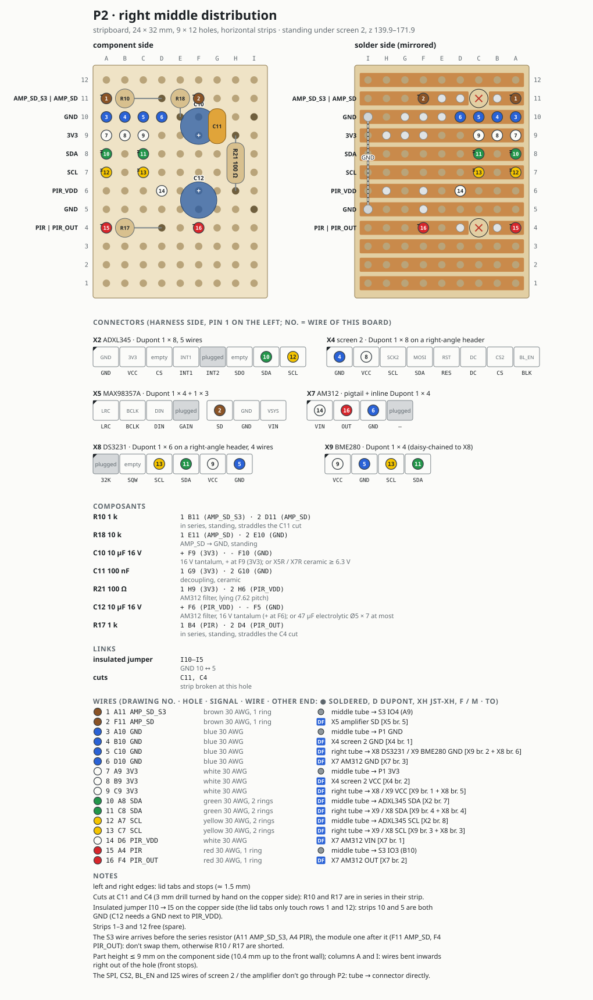
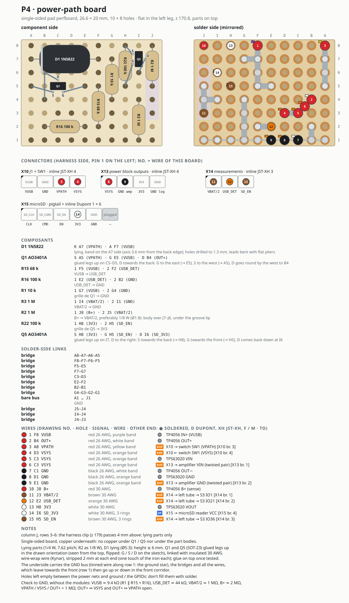

- **S3 carrier**: the 2 × 8 female headers and every part (R11–R14, R19, R20, C6, C8 standing, C1 lying flat) on the component side
  under the S3; on the solder side only the GND bus (column E), the bridges, three insulated jumpers and the 27 wires,
  each soldered on its pin's tail or pad and leaving inwards. Cut 1.2 mm below row 1 and 2.7 mm above row 13 (row 4,
  the first pin row, 8.8 mm above the S3's USB edge). The headers are glued to the board (only single-sided pads hold
  them); the V (VBUS) contact is pulled out. Rows 3 and 12 stay clear at the edges (lid tabs), rows 12–13 under the
  antenna stay empty.
- **P1 / P2**: wires go in from the component side and are soldered on the copper side (towards the lid); P2 has two
  strip cuts (C11, C4) for the series resistors R10 / R17 and an insulated jumper I10 → I5 on the copper side. Only
  30 AWG in columns A / I, bent inwards (the front stops cover 1.5 mm of each edge); parts ≤ 9 mm tall.
- **Power-path board**: parts on top (all lying, D1 1N5822 axis 3.6 mm from the back edge, Q1 / Q5 glued upside down
  with insulated 30 AWG wire-wrap leads), the GND star bus along the front row and every wire on the underside,
  leaving towards the front channel. OUT+ has its own pad (B4) with no neighbour; R2 (B+) lies J8 → J5, away from Q5.
  Column J rows 3–6 stay flat: the tie anchor at z 179 is 4 mm above.

## Connectors (demountable wiring)

Everything is tested **on the bench first**, then fitted, and any module can come out again **without
re-soldering**. The harness is soldered once (P1, P2, the S3's carrier, the power-path board, the cell plates and the
bundles through the tubes, which cannot be threaded with connectors on them anyway); **every module plugs into it**.
One family for nearly everything: **2.54 mm Dupont crimp housings**, pushed straight onto the modules' own header pins,
so on the bench the same modules take ordinary breadboard jumpers. Where a header has no room (the microphone, the
AM312, the microSD), a 5–6 cm pigtail soldered on the module ends in an inline Dupont pair. The 26 AWG power wires get
locking **JST-XH** (3 A) inline pairs, crimped like the Dupont ones (X10, X12–X14, X16).

Modelled in `mechanical/scad/tars4.scad` (`plugs`, the `CONN` list): each connector is a box (mated housings + 4 mm to bend the wires)
checked against the walls, screw posts, splints, shelves, boards, lid tabs, tie anchors, pivot bosses, C7, a bundle
corridor in the middle columns (tube end → P1 / P2) and the other connectors: the model echoes a WARNING on any clash
(none now). Side sections, connectors in orange (`python3 -I tools/column_sections.py`):

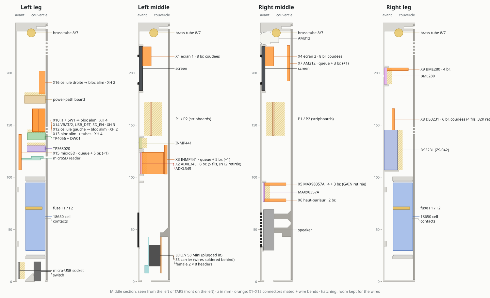

The two legs from the back, lid off (`tools/build4.sh renders`): left leg, its power block connectors in a cut just
above them (seen from behind, so TARS's left is on the right: X12 / X13 against the lid, X10 / X14 in front, the
front channel free), the XH pairs from behind (male housing below, from `connectors.scad`'s `XH()`, XHP female
plugged in from above, inside their translucent check box), right leg and its DS3231 / BME280 area. Every connector
is drawn in detail inside its check box (`xh_pair()`, and `dupont()` for X1–X9 / X15: header base + female housing,
or the two housings of an inline pair, with coloured wire stubs). The mated pair
drawn is ~17 mm long (`xh_male_back`, `xh_female`) inside the 22 mm checked box (`xh_inline`): measure a real pair.

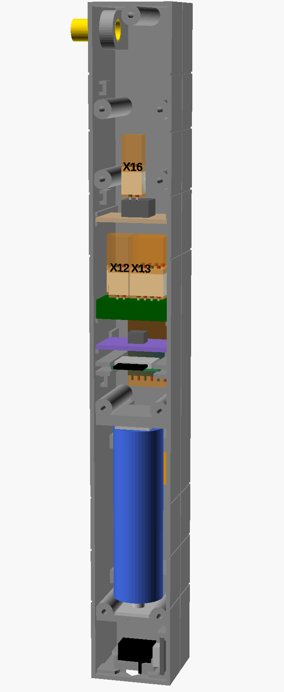 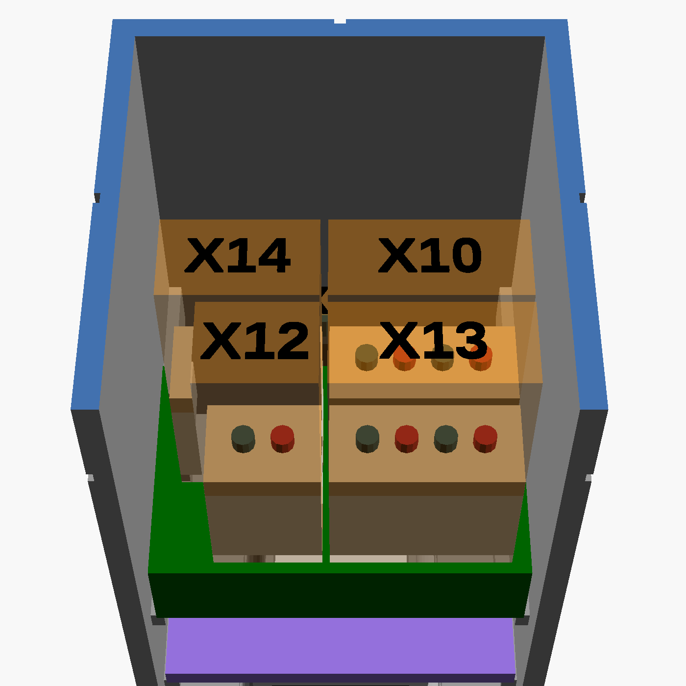
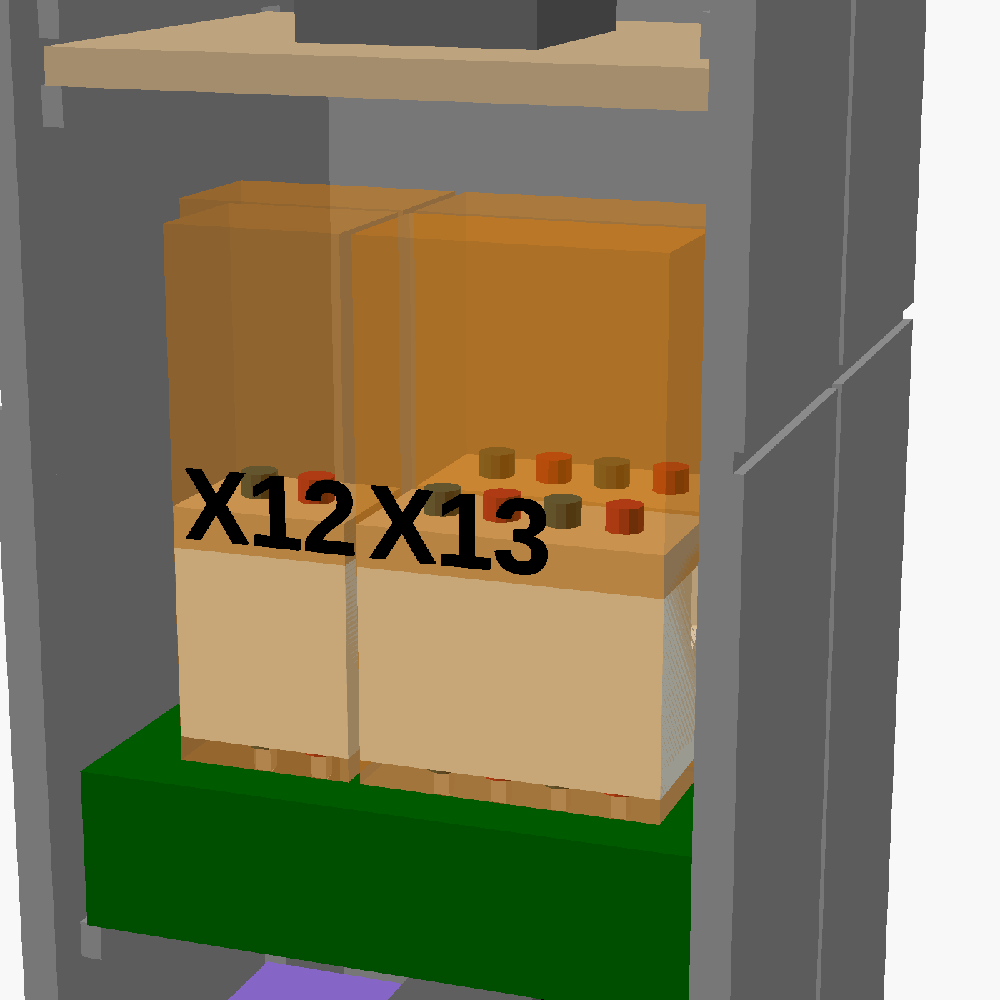
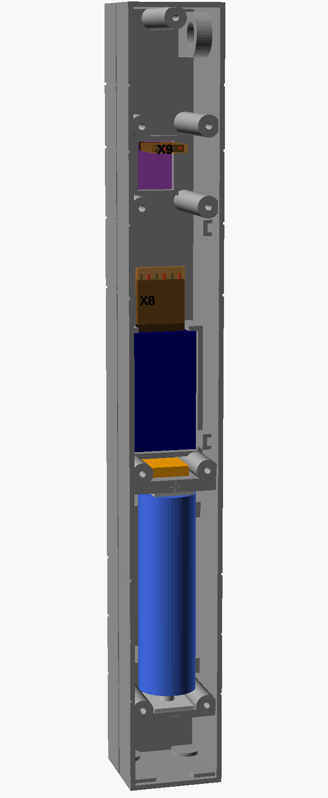 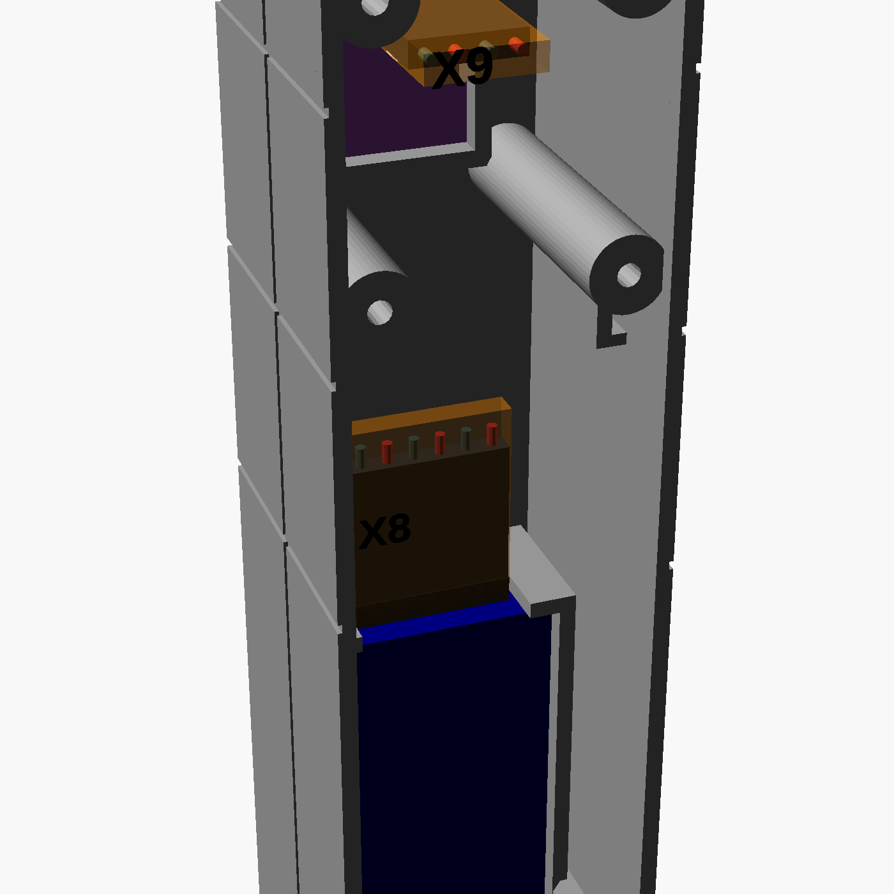

| Ref | Module ↔ harness | Type · keying (pin order from pin 1) | Where (z, mm) |
|---|---|---|---|
| (socket) | **LOLIN S3 Mini** ↔ its carrier | 2 × (2 × 8) female headers, 8.5 high | left middle, 8–43: open the lid, slide S3 + carrier out on their wire loop, pull the S3 off |
| X1 | screen 1 | Dupont 1 × 8 (GND VCC SCL SDA RES DC CS BLK) on a **right-angle header** on the screen's back, pins down; the housing lies flat on the back · **1 mm rib glued on its lid-side face**: reversed, the rib hits the screen board | left middle, 205–223 |
| X2 | ADXL345 | Dupont 1 × 8 (GND VCC CS INT1 INT2 SDO SDA SCL; 5 wires) · **INT2 pin pulled**, its cavity plugged · SDA / SCL contacts carry **two wires** (S3 carrier + on to P2); VCC / GND come from X3's harness side | left middle, along its left edge, 103–124 |
| X3 | INMP441 | pigtail + inline Dupont 1 × 6 (SCK WS SD VDD GND + 1 empty; L/R bridged to GND on the board) · empty position plugged on the female side · VDD / GND female contacts carry **two wires** (from P1 + on to X2), so unplugging the mic keeps the ADXL345 powered | left middle, parked against the lid, 103–131 |
| X4 | screen 2 | as X1 | right middle, 205–223 |
| X5 | MAX98357A | **two housings**: 1 × 4 (LRC BCLK DIN GAIN) with the **GAIN pin pulled**, cavity plugged, + 1 × 3 (SD GND VIN) · the 3-way reversed only swaps SD and VIN through R10 1 k (harmless); mark the 4-way's side | right middle, top edge of the amp, ~93 |
| X6 | speaker | Dupont 1 × 2 on a 2-pin header in place of the screw terminal · no key (reversed = polarity swap, harmless) | right middle, bottom edge of the amp, ~78 |
| X7 | AM312 | pigtail + inline Dupont 1 × 4 (VIN OUT GND + 1 empty) · empty position plugged | right middle, parked against the lid beside the screen, 191–225 |
| X8 | DS3231 (ZS-042) | Dupont 1 × 6 on its right-angle header (32K SQW SCL SDA VCC GND; 4 wires) · **32K pin pulled**, cavity plugged | right leg, above the board, 145–166 |
| X9 | BME280 | Dupont 1 × 4 (VCC GND SCL SDA) · no key: reversed, the I2C bus just hangs (no supply short) · all 4 contacts carry **two wires** (from P2 + on to X8) | right leg, top edge, ~204 |
| X10 | J1 charge port + SW1 ↔ power block | **JST-XH 4** inline (VUSB, GND, VPATH, VSYS), polarised: the two floor cables (charge port, switch) end in one housing (X11 no longer exists) | left leg, parked above the TP4056, front row, 144–166 |
| X12 | left cell ↔ power block | JST-XH 2 inline (B+, B−), female on the cell side | left leg, parked, 144–166 |
| X16 | right cell ↔ power block | JST-XH 2 inline (B+, B−), female on the cell side: the pair comes down from the tubes; the two cells join on the TP4056's B+ / B− pads (two wires soldered on each) | left leg, above the power-path board between the lid screw posts, 180–202 |
| X13 | power block ↔ tubes | JST-XH 4 inline (amp VSYS / GND, 3V3, logic GND) | left leg, parked, 144–166 |
| X14 | power block ↔ tubes | **JST-XH 3** inline (VBAT/2, USB_DET, SD_EN), polarised | left leg, parked, front row, 144–166 |
| X15 | microSD reader | pigtail + inline Dupont 1 × 6 (CLK CMD D0 3V3 GND + 1 empty) · empty position plugged | left leg, front channel, 107–141 |

- **Keying** (2.54 Dupont housings are not polarised): pull an unused header pin off the module and plug the matching
  housing cavity with a cut-off male pin glued in; inline pairs get one extra position, plugged on the **female side,
  which is always the powered harness side** (no live pin exposed). Plug and unplug only with SW1 off, the charger and
  the S3's USB-C out.
- **Power block**: the TP4056, the power-path board and the TPS63020 are soldered together once (4–5 cm loops) and
  bench-tested as one unit; X10, X12–X14 and X16 are its only joints with the rest, parked in the free cavity above the TP4056
  (z 144–166, y 18–29). The boards go into their flat slots **one by one** from the back, bottom-up, on their loops;
  the through-wires (microSD, right cell) run in the front channel.
- **S3 carrier**: **single-sided perfboard with separate pads** (not stripboard: the S3's pins sit in two double rows), cut to
  25.6 × 34.4 (1.2 mm below the first row), pad-free bands at 4.5–7 and 27.9–30.4 for the ribs / lid tabs. Wires on its back in the 6 mm gap with a
  **6–8 cm service loop**; C1, R11–R14, R19, R20, C6 and C8 stand on its component side under the S3
  (`renders/tars4_board_s3.svg`).
- **Two wires in one contact** (X2 SDA / SCL, X3 VDD / GND, X9 VCC / GND / SCL / SDA: 8 contacts): crimp both 30 AWG
  together without folding.
- **Crimping 30 AWG in Dupont contacts** (made for 22–28 AWG): strip 3 mm, fold the strands back once to double them,
  crimp the conductor wings on that; slide 5 mm of 1.5 mm heat-shrink on first and crimp the insulation wings over it.
  Tug-test every contact. Ratchet crimper SN-28B / PA-09. Mark each housing with its X number and a dot of paint on
  pin 1. Pull each harness end ≥ 5 cm out of the back to crimp it. A drop of hot glue on each housing once the bench
  test passes; tape X3 / X7 to the lid side.
- **Service loops**: 3–5 cm of slack at every module so it comes out of the back on its wires before being unplugged;
  no loop within 25–30 mm of a tube end.

### Assembly order

1. Print, glue the halves and splints.
2. Parts on the front wall: screens, ADXL345, INMP441, amp, BME280, DS3231 with B+ pre-formed, speaker, charge port,
   switch, fuses + contact plates.
3. Tubes glued in their fixed column, harness threaded bare, collars.
4. Flat boards bottom-up from the back (microSD, power block); P1 / P2; the S3 + carrier last.
5. Plug X1–X15, continuity check P1 / P2 → every housing, tie the bundles to the printed anchors.
6. Close the lids (nothing over a post), test, cells last.

## Switch, feet, stability

- **Switch** SW1: mini slide switch (body 12.95 × 6.9, lever 3.88 × 3.88 counted as 4 × 4, 6 mm travel) in the
  **left leg** floor, upside down on a 4 mm pad (45° slope) inside a 2 mm frame. The lever tip sits **0.5 mm above the
  underside of the floor**: nothing sticks out, it is flipped with a pen tip through the 10.6 × 4.6 slot. Wired after
  the power-path merge, before VSYS; charging works with it off.
- **Feet**: 4 recesses Ø8.4 × 0.8 under every column for stick-on rubber feet.
- **Stability** (echoed by the model): ~400 g, centre of gravity ~112 mm high → standing straight, TARS tips over past
  only **~8°** front/back (31 mm deep base). Display it in the **walking pose** (legs swung 10–15°) or keep the
  detents firm; rubber feet help against sliding, not tipping.

## Bill of materials

**Electronics**

| Item | Qty | Notes |
|---|---|---|
| U2 **LOLIN S3 Mini** (wemos.cc original, ESP32-S3FH4R2) | 1 | 34.3 × 25.4, USB-C; male headers soldered pins to the back, plugged into its carrier |
| U3, U4 1.3" IPS 240×240 ST7789 SPI module **with CS** (8 pins), board 27 × 42 | 2 | `lcd130cs` |
| BT1, BT2 18650 Li-ion cell | 2 | one per leg; 18500 also fits (`bat = [18.5, 50]`) |
| Battery contact plates 13 × 18 × 1.2: spring (Ø5, 10.7 high) + button (+, 1.8 overall) | 2 pairs | one pair per leg, wires soldered on the tabs |
| U1 TP4056 charger breakout, **protected (DW01)**, 28.7 × 17.15 × 0.9 (26.3 once its micro-USB is desoldered and the nubs filed) | 1 | left leg, flat above the TPS63020; fed by J1 on its IN pads; **R_PROG swapped for 2.4 k** (0.5 A) |
| J1 micro-USB breakout | 1 | charge port in the left foot, plug from behind at the heel |
| SW1 mini slide switch, 3 pins (1P2T), body 12.95 × 6.9, lever 5.15 | 1 | left leg floor; **check its current rating** (≥ 1 A) |
| U9 **TPS63020** buck-boost module, 3.3 V, EN + PS/SYNC, ~17.4 × 26.2 | 1 | left leg, flat above the microSD; EN to VIN, PS/SYNC to GND |
| U7 DS3231 RTC board (ZS-042) + CR2032 | 1 | right leg, I2C; SQW not wired |
| U8 ADXL345 accelerometer board (GY-291) | 1 | left middle, I2C |
| U6 INMP441 I2S microphone board, 10 × 10 | 1 | left middle, Ø1 hole in the decor groove |
| U11 **BME280** board, purple GY-BME280, 3.3 V | 1 | right leg (z ≈ 190), Ø1.5 vent; remove its LED if it has one |
| U10 **AM312** mini PIR motion sensor | 1 | top of the right middle column, z ≈ 233, 1.25 mm right of the axis |
| J2 microSD breakout, 3.3 V, **no regulator**, 18.2 × 18.2 × 1.5 (21 with the socket) | 1 | left leg |
| U5 MAX98357A I2S amplifier breakout | 1 | right middle; VIN / GND on their own twisted pair from the power board |
| LS1 speaker 39 × 22 × 10 mm, 8 Ω | 1 | behind the lower black panel of the right middle column |
| Q1 P-MOSFET **AO3401A** (or DMG2305UX / SI2301), SOT-23 | 1 | power path, battery side; glued upside down on the perfboard |
| Q5 P-MOSFET **AO3401A** + R22 **100 kΩ** | 1 + 1 | switch the microSD's 3V3 (SD_EN, GPIO36), on the power-path board |
| D1 Schottky **1N5822** (through-hole, 3 A) | 1 | power path, USB side, band towards VPATH (before the switch; 1N5818 also does) |
| D3 **TVS SMAJ5.0A / SMBJ5.0A** (unidirectional) | 1 | on the TP4056's IN+ / IN− pads, cathode to IN+ |
| F1, F2 **polyfuse** (radial PPTC), ≥ 16 V (MF-R160: 30 V), hold **1.6 A** | 2 | one in each cell's + wire, standing on the inner front wall in front of the cell (XF160 15 × 16 × 2.5) |
| R1 **10 kΩ** | 1 | power path, MOSFET gate pull-down |
| R2, R3 **1 MΩ** (R2 preferably 1/8 W, Ø1.8) | 2 | B+ divider (battery monitor), on the power-path perfboard; R2 lies along its edge, under the groove's lip |
| R15 **68 kΩ**, R16 **100 kΩ** | 1 + 1 | VUSB → USB_DET divider, on the power-path perfboard |
| **2.4 kΩ** (through-hole 1/4 W, or SMD 0805 / 1206) | 1 | replaces the TP4056's R_PROG (1.2 k, removed). A through-hole one can hang on two short wires (≤ 2 cm) on the R_PROG pads, heat-shrink over each joint and the body, glued flat within 5.5 mm above the board (`charger_h`). **The PROG node must never touch GND** (charge current unlimited); a broken wire only stops the charge |
| R4, R18 **10 kΩ** (+ R5–R9 10 kΩ) | 2 (+ 5) | R4 BL_EN → GND (P1), R18 amp SD → GND (P2); R5–R9 microSD pull-ups, only if the reader has none |
| R10, R17 **1 kΩ** | 2 | in series GPIO4 → amp SD, AM312 OUT → GPIO3, on P2 |
| R11, R13, R14, R20 **33 Ω** | 4 | microSD CLK, amp BCLK, amp LRC, MOSI, at the S3 pins |
| R12, R19 **47 Ω** (+ 68 / 100 Ω to try) | 2 | SCK split on the S3's carrier |
| R21 **100 Ω** + C12 **10 µF tantalum 16 V** (+ to PIR_VDD, F6), or a 47 µF electrolytic Ø5 × 7 at most | 1 + 1 | RC filter on the AM312's supply, on P2 (parts ≤ 9 mm in front of it) |
| C1 **220 µF SMD 7343** (7.3 × 4.3), Panasonic POSCAP 10TPE220ML, polymer tantalum 10 V, ESR 25 mΩ (in stock) | 1 | **required**, 3V3–GND at the S3, lying flat on the carrier under the S3 (C2 + / E2 −, a lead offcut soldered on each end); **SMD tantalum band = +** |
| C2, C4, C10 **10 µF tantalum 16 V** (+ to 3V3; in stock) or ceramic X5R/X7R ≥ 6.3 V ("106"), 2.54 pitch, h ≤ 9 | 3 | P1 (G9 + / G10), microSD reader (C4 **lying flat** on its pins: only ~6.6 mm to the TPS63020), P2 (F9 + / F10) |
| C3, C5, C6, C8, C11 **100 nF ceramic**, through-hole, 2.54 pitch, small body (≤ ~4 mm wide, h ≤ 9 on P1 / P2, ≤ 10 under the S3) | 5 | P1 (H9–H10), microSD reader (on its pins), GPIO1 and GPIO21 at the S3 (under it between the headers, ~0.1 mm to their plastic), P2 (G9–G10); **C6 never a tantalum** (leakage on VBAT/2); a 7.15 × 2.4 film fits only C3 (H9–H11) and C5 |
| C7 electrolytic **470 µF**, 10 V (Ø8 × 12) | 1 | on the amp's VIN / GND pins, lying across behind the board |
| C9 electrolytic **22 µF** (10–47 µF), 16 V, **Ø ≤ 5.15** lying (`charger_h` 6) | 1 | on the TP4056's IN pads next to D3 |
| Q2 AO3401A + Q3 AO3400A / 2N7002 + 10 kΩ | (1 + 1 + 1) | only if the screens' BLK draws the LED current (see *Signals*) |
| Stripboard 2.54 mm (single-sided), cut to **24 × 32** (9 × 12 holes) | 2 | P1, P2: `renders/tars4_board_p1.svg`, `_p2.svg` |
| **Single-sided** perfboard (FR4) with separate pads, cut to **26.6 × 20** (10 × 8 holes) | 1 | power path (Q1, D1, R1, R2 / R3, R15 / R16, Q5 / R22, star ground), `renders/tars4_board_power.svg` |
| **Single-sided** perfboard (FR4) with separate pads, cut to **25.6 × 34.4** (10 × 13 holes) | 1 | the S3's carrier, `renders/tars4_board_s3.svg` |
| Female headers **2 × 8**, 2.54, 8.5 mm high | 2 | the S3's socket (`s3_sock_h` MEASURE) |
| **Right-angle** male header 1 × 8 | 2 | X1 / X4, on the screens' backs, pins down |
| Male header 1 × 2 | 1 | X6, in place of the amp's screw terminal |
| **Dupont 2.54 crimp kit**: housings 1 × 2 … 1 × 8, female contacts (**~100**, ~55 used), male contacts (~20) | 1 kit | X1–X9, X15; ratchet crimper SN-28B / PA-09; spare male pins to plug the keyed cavities |
| **JST-XH** (2.50 pitch) inline pairs to crimp: housings 2-, 3- and 4-pin, male + female, with their contacts | 2 + 1 + 2 | X12, X16; X14; X10, X13 (SN-28B crimper; 30 AWG folded like in the Dupont contacts) |
| Silicone wire **30 AWG**, tinned copper (not CCA), **10-colour kit** (needs purple and blue) | ~20.3 m | cut lengths from the 3D model in `hardware/tars4_harness.pdf` (estimate + 3 cm each, service loops and pigtails included); ≤ 3.6 m per colour (yellow); 8 colours used, no black / grey |
| Silicone wire **26 AWG** | ~7.7 m: red 3.3, black 2.5, blue 0.8, white 0.8, grey 0.3 | power pairs: B+/B− of each cell, VSYS / VUSB / VPATH and their GND (red / black), 3V3 / logic GND to P1 (white / blue), amp pair, speaker (grey) (cut lengths in `hardware/tars4_harness.pdf`) |
| **Wire-wrap wire 30 AWG** (Kynar insulated), 1 small spool | 1 | Q1 / Q5 leads on the power-path board, insulated jumpers |
| **Tinned copper wire** 0.5–0.6 mm (or cut resistor leads) | ~0.5 m | bare GND buses (carrier column E, power-board row 1) |
| Cyanoacrylate or 5-minute epoxy | — | the S3's female headers on the single-sided carrier |
| USB charger **5 V ≥ 2 A** + micro-USB cable | 1 | mains operation while charging |
| Heat-shrink 1.5–3 mm, **coloured assortment** (black, white, yellow, orange, purple at least) | ~1 m | twisted pair ends, solder joints, Dupont insulation wings, tube exits; black signal-bus rings; coloured power-rail bands (white OUT+, yellow VPATH, orange VSYS, purple VUSB, ~40 × 10 mm) |

**Hardware**

| Item | Qty | Notes |
|---|---|---|
| Brass tube 8 / 7 mm, cut to ~20 mm | 3 | one per joint |
| M2.5 × 6 (or × 8) screws, **thin / ultra-low head, black** (head Ø~5, height ≤ 2) | 32 | lids: 7 per middle column, 9 per leg. Threaded **straight into the printed bosses** (Ø2.1 pilot, 9 deep) through the lid (Ø2.9 hole): × 6 engages 4.4 mm, × 8 6.4 mm. Good for ~10–20 openings: turn backwards until the thread clicks, then tighten, snug only. Upgrade: drill the pilots to 3.5 for M2.5 heat-set inserts |
| M2 × 5 self-tapping screws | (8) | only if the measured screen has usable mounting holes |
| Rubber feet, stick-on Ø8 (e.g. 3M Bumpon) | 16 | 4 per column |
| Epoxy (splints, tubes, collars), CA (plugs) | | |

**Filament**

| Material | Parts | Approx. |
|---|---|---|
| Matte grey PLA | 8 column halves, 8 lid halves, 4 splints | ~350 g |
| Matte black PLA | panel plugs | < 10 g |
| PETG (any colour) | 3 tube collars | < 5 g |

## Bring-up checklist (when the parts arrive)

What is left to buy: `hardware/shopping_list.md`. Open questions and measurements: `open_questions.md`.

**1. Measure and update the `MEASURE` values in `mechanical/scad/tars4.scad`** (then `tools/build4.sh stl`,
`python3 -I tools/update_orca_project.py mechanical/3mf/tars4.3mf`)
- [x] LOLIN S3 Mini: 25.4 × 34.5 × 1.0, notch 2 × 7, BOOT sticks out 1.3 on the right (window through the wall,
      `d1_boot_window`). All measurements of 2026-10-27: `hardware/measurements.md`.
- [x] 1.3" CS screen: 27.35 × 42.12 × 3.3, glass 7.2 / 5 from the short edges (`active_dz` −1.1, assuming the active
      area centred in the glass: check lit with a test pattern; print the screen test piece first, see above).
- [x] TPS63020 module: 26.7 × 17.7 × 1.6, slot cut into the walls (`bk_clr` 0.4); wire only the inner pad of each corner
      pair. - [ ] `bk_h` (inductor height).
- [ ] microSD reader: `sd`, `sd_sock`, `sd_sock_dx`, `sd_sock_over`, `sd_card_out`, `sd_lip`; the card clicks in
      through the lid slot.
- [x] Stripboard 1.61 thick (`hub_b[2]` 1.6); cut P1 / P2 to 24 × 32.
- [x] TP4056 board lying flat: 28.7 as bought → **desolder its micro-USB and file off the two panel-break nubs** →
      26.3 × 17.15 × 0.9, on 0.5 ledges (end pads centred 1.43 from the edge), no side grooves. Cells 65 × 18.3 (fit).
      - [ ] contact plates, switch body.
- [x] Micro-USB breakout 14.3 × 16 × 1.5, plug overmold 7.9 × 5.5 (fits). - [ ] USB-C plug
      overmold ≤ 11.5 wide (S3 floor opening); speaker 39 × 22 × 10 and MAX98357A sizes.
- [x] Power-path perfboard 1.5 thick (26.6 × 20, 10 × 8 holes); D1 lying 5.2 (`pp_parts` 6).
- [ ] Every board soldered on the wall side (ADXL345, MAX98357A, micro-USB, spare): solder tails ≤ 1 mm (`pcb_gap` 1.2).
- [x] Screens' backs: parts 3 high from 8.7 below the pad row, clear of the right-angle header + housings (dry fit,
      6.9 from the PCB back); C7 8 × 11.5.
- [x] Connectors: female header 8.4, male spacer 2.4, screen header row 1.4, ZS-042 header depth ~4, XH (male 8,
      female 7, mated 9.7). - [ ] Dupont housing
      (`dp_t`, `dp_on`, `dp_inline`), XH pairs (`xh_inline`); screen header row → `scr_hdr_dz`,
      ZS-042 header depth → `rtc_hdr_y`. The model must echo no connector WARNING afterwards.
- [x] Polyfuses XF160 15 × 16 × 2.5: too wide for the top shelf → standing on the inner front wall in front of each cell.
- [x] BME280 12 × 15.6 × 2.6, sensor centred. - [ ] no regulator (3.3 V straight to the sensor), no LED.
- [x] Pivot bores: tube 7.93; `tube_test3` (teardrop bores, the round ones sagged ~0.3): G7.95 scrapes, **G8.00 holds**
  with no play, **R8.05 turns** with micro play, wider bores get looser → teardrop pivots 8.00 / 8.05
  (PLAT-MECH-PIVOT-001). A bore that binds: sand or ream with an 8 mm drill.
- [x] AM312: `pir_test` printed, cap glued from the inside, Ø11.5 hole (dome flush). - [ ] measure `pir_pcb_dn`.

**2. Check on the bench, before wiring** (multimeter)
- [ ] Screen BLK ↔ VCC resistance (power off): note any pull-up. BLK current with the screen on (a few mA expected:
      then no Q2 / Q3).
- [ ] MAX98357A breakout: SD pull-up value (Adafruit: 1 M to VIN). With a 100 k pull-up, R18 → **2.2 k**; if SD is
      tied to VIN, cut the trace.
- [ ] D1 (1N5822) reverse leakage at 4.2 V, at 35 °C (hot room; D1 only blocks on battery, the charger is off then and does not heat the leg): > 50 µA → R1 4.7 k or a lower-leakage Schottky.
- [ ] AM312 output high level at 3.3 V > 2.5 V; DW01: does it switch on by itself when the cells are first connected?
- [ ] TP4056: R_PROG swapped for 2.4 k (~2.4 k across it, module unpowered).
- [ ] TPS63020: **output 3.3 V unloaded** (never 5 V), idle current with EN on, PS/SYNC bridged to GND.
- [ ] Slide switch current rating (≥ 1 A).
- [ ] ZS-042: CR2032 charging resistor removed.
- [ ] **Every power / status LED fed from the battery removed**: ZS-042, TPS63020 module, GY-291, microSD breakout, the
      S3 Mini's RGB LED (GPIO47). Keep the TP4056 charge LEDs (USB-fed).
- [ ] Both 18650 at the same voltage (± 0.05 V).

**3. Bring-up, one element at a time** (multimeter at each step; a bench supply at 3.7 V / 300 mA stands in for the
cells until step 3.5; nothing goes on the 3V3 before step 3.6 is green)

*3.1 TP4056 module alone*
- [ ] USB in (its own micro-USB), nothing on B+/B−: LED behaviour, VUSB = 4.75–5.25 V at the IN pads.
- [ ] Bench supply on B+/B− (3.7 V): OUT+ ≈ B+, OUT− ↔ B− conducting; supply current with USB out < 10 µA for the TP4056 alone (the whole block adds D1's leakage, up to tens of µA: note it).
- [ ] Charge current into a half-empty cell ≈ 0.5 A; the cell goes to 4.2 V ± 1 % and stops; TP4056 < 60 °C after 15 min
      in open air.
- [ ] D3 and C9 on the IN pads, **D3 band (cathode) and C9 + on IN+**: VUSB unchanged, no heating, IN+ ↔ IN− not shorted.

*3.2 Power path (Q1, D1, R1) + SW1, VSYS loaded with 33 Ω (~110 mA)*
- [ ] USB in: VSYS ≈ VUSB − 0.3 to 0.5 V, current from the bench supply ≈ 0 (Q1 off).
- [ ] **USB out: VUSB < 0.5 V within ~1 s, and VSYS within 0.1 V of VBAT** (Q1 fully on). A 0.5–0.7 V drop means Q1
      runs on its body diode (R1 missing / wrong, or D1 leaking): fix before going on.
- [ ] Plug / unplug the USB under load: VSYS never below ~3.0 V (multimeter min-hold, or scope).
- [ ] SW1 off: VSYS = 0, supply current ≈ 0. SW1 on with 1 A load (3.9 Ω 5 W): Q1 and SW1 barely warm.

*3.3 Dividers on the power-path board*
- [ ] VBAT/2 = B+ / 2 ± 2 % with the switch on **and** off, and with the charger plugged in (10 MΩ multimeter loads the 500 k
      node by ~5 %: compare with GPIO1 later).
- [ ] USB_DET ≈ 3.0 V with USB in (never > 3.3 V), < 0.2 V with USB out.

*3.4 Polyfuses, cells, star ground*
- [ ] Polyfuses cold < 0.2 Ω each. Cells in: each branch reads the same voltage; drop across each polyfuse at 1 A < 0.15 V.
- [ ] B− / OUT− / TPS GND / amp GND all < 0.1 Ω to the star point.

*3.5 TPS63020 module, nothing on its output*
- [ ] **VOUT = 3.3 V ± 3 % unloaded**, input idle current well under 0.1 mA (a few mA = stuck in PWM, check PS/SYNC).
- [ ] VOUT with 33 Ω and 6.8 Ω (~500 mA): still 3.3 V, module not hot; VIN swept 3.0 → 4.2 V: VOUT steady.

*3.6 3V3 distribution: P1 with C2 / C3, C1 at the S3's 3V pin, P2*
- [ ] Before connecting the TPS: 3V3 ↔ GND on P1 > 1 kΩ, C1 / C12 polarity, strip cuts checked.
- [ ] TPS connected: 3.3 V at P1 and at the S3's 3V pin.

*3.7 S3 Mini alone on the 3V3*
- [ ] Boots from the TPS (no USB-C): idle current on VSYS; Wi-Fi TX peaks keep 3V3 > 3.1 V.
- [ ] VBAT/2 read by GPIO1 = multimeter value ± 3 % (ADC calibration); USB_DET on GPIO21 follows the charger.
- [ ] S3's USB-C in a PC that is **off**, on battery: current from the cells into its VBUS ≈ 0; with the PC on,
      flashing works with SW1 on or off.

*3.8 Peripherals, one at a time, measuring the 3V3 current added by each*
- [ ] Screen 1, then screen 2 (backlight off at boot unless BLK has a pull-up; PWM dimming works); total BLK current at
      GPIO7 < 10 mA (else Q2 / Q3).
- [ ] MAX98357A: off at boot and with GPIO4 low (SD < 0.1 V), VIN = VSYS, C7 + to VIN; loud sound: VSYS > 3.0 V, no
      brown-out.
- [ ] INMP441: I2S1 data present. DS3231: 0x68 through both tubes, CR2032 not charged. ADXL345: 0x53, INT1 toggles.
- [ ] microSD: CMD / D0–D3 read 10 kΩ to SD_3V3, init at 10 MHz 1-bit, 3V3 dip at insertion < 0.1 V; GPIO36 high →
      SD_3V3 < 0.1 V; sleep current with and without the card.
- [ ] BME280: 0x76 (or 0x77) next to 0x53 / 0x57 (DS3231 EEPROM) / 0x68; pull-up total ≥ 1.1 k; temperature vs a reference thermometer cold
      and after 10 min running → offset.
- [ ] AM312 + R17: ~15 µA idle; GPIO3 ≈ 0 V idle, ≈ 3.3 V on motion, held ~2 s; no false trigger during Wi-Fi bursts and
      backlight PWM (else 1 nF on GPIO3); a hand waved in front wakes the S3 from deep sleep.

*3.9 Whole robot*
- [ ] Deep-sleep current from the cells (target above; LEDs removed, DS3231 32 kHz off, pins held); wake by USB_DET,
      ADXL INT1, PIR and the S3 timer.
- [ ] 30 min running + charging on a 5 V ≥ 2 A charger: VUSB ≥ 4.6 V at 1 A load; TP4056, Q1, D1, TPS63020
      finger-warm at most; end of charge at 4.2 V.
- [ ] Note every measured value here (it feeds the `MEASURE` values and the firmware thresholds).

**4. Print** (`mechanical/3mf/tars4.3mf`, or the CR-10 plate)
- [ ] bed levelling (`part="print_test_level"`) and screen fit (`part="print_test_screen"`), exported by hand from the scad if needed, then the plates; PETG collars, black PLA plugs.
- [ ] Check the lid slot / microSD, the TPS63020 and P1 / P2 grooves on the printed parts before gluing the splints.

**5. Firmware**
- [ ] GPIO map from `hardware/tars4_schematic.html`; SPI 26.7 MHz first (scope SCK at screen 2 if possible), then 40 MHz;
      backlight PWM ~20 kHz; `RST = -1`; I2S0 amp, I2S1 microphone; SDMMC 1-bit 10 MHz; I2C 100 kHz.
- [ ] Charger detect: USB_DET high = on mains (no cut-off, charging icon); charge done ≈ B+ relaxing to ~4.15 V with
      USB_DET still high.
- [ ] Battery: cut-off 3.3 V on B+ (ignore below 2.5 V), "empty" flag in RTC memory; BL_EN, AMP_SD and I2S0 off until
      B+ is validated; Wi-Fi TX power limited if needed.
- [ ] Deep sleep / wake-up as in *Deep sleep and wake-up*.
- [ ] **Irony cue**: in the film it is a white dot that appears *inside* the screen → drawn on the right screen, no LED.

## Open questions

Live list: `open_questions.md` (tube test3, VSYS sense hardware, charger D13 / temperature E-M8, bench measurements).
Also: replaceable PETG detent rings.

## Requirements

The platform is specified in `requirements/` (requirement-based development, `.rbd/config.yml`): FUNC (what the
robot does), TECH (constraints), PERF (measurable limits), CONF (settings), PLAT (how it is built on this hardware,
each deriving from a FUNC / TECH requirement), UI. IDs are `<CAT>-<DOMAIN>-<FEATURE>-NNN`. Written so far: the POWER
domain (validated, or `draft` while a bench measurement is pending). Module currents: `hardware/power_budget.md`.

## Branches

| Branch | Content |
|---|---|
| `main` | the design (model, hardware docs, requirements) |
| `bench-tests` | bench test firmware for the D1 mini and the S3 Mini (`d1mini/`, `s3mini/`, `bench_assets/`), not merged |

## Rebuild

Step by step, offline included: `CONTRIBUTING.md`.

```
cd ~/git/Tars
tools/build4.sh                           # all half STLs, the 3 raw plates, renders (~10 min)
tools/build4.sh stl                       # only the STLs
tools/build4.sh renders                   # only the renders
openscad mechanical/scad/tars4.scad       # interactive; `part` selects what is shown
python3 -I tools/boards.py                # board layouts, checked (renders/tars4_board_*.svg)
python3 -I tools/update_orca_project.py mechanical/3mf/tars4.3mf   # swap the Orca project's meshes
```

**Validation** (`make check`; also the git pre-commit hook, installed by `make hook`). **Incremental**: each stage
runs only when its input files changed since its last pass (a geometry change: ~9 min; a wire colour change: the docs
stage only, ~40 s; nothing changed: instant). `make check-all` forces every stage, `make check-<stage>` one stage.
Logs in `build/check/`.

| Stage | Runs when | What fails it |
|---|---|---|
| stl | `mechanical/scad/tars4.scad`, `build4.sh`, the OpenSCAD libraries change | any print part (Ender 3 halves, CR-10 one-piece, the `tube_test3` trial print) with an OpenSCAD `WARNING` / `ERROR`; a raw plate (written to `build/plates/`) off the 220 × 220 bed |
| meshes | **pre-push** (`make check-meshes`, not part of `make check`), when the STLs or the Orca projects change | `tools/update_orca_project.py` on `mechanical/3mf/tars4.3mf` and `tars4_cr10.3mf`: meshes swapped for the current STLs, layout kept, backup in `backups/`; an up-to-date project is not rewritten. The pre-push hook then refuses the push until the rewritten projects are committed |
| overhang | **only on request** (`make check-overhang`, not part of `make check`: overhangs are checked in Orca) | `scripts/overhang.py` (uv + trimesh): a region over 2 cm² facing down more than 50° from vertical, unless it is a ceiling narrower than 3 mm (bridge) or listed with its reason in `scripts/overhang_allow.json` (`--limit 45` for a stricter pass) |
| orca | **only on request** (`make check-orca`, not part of `make check`: needs the OrcaSlicer AppImage) | `scripts/orca_check.py` refreshes the meshes of `mechanical/3mf/tars4.3mf` (Ender 3) and `mechanical/3mf/tars4_cr10.3mf` (CR-10) in place (layout kept, backup in `backups/`; same as `update_orca_project.py`), then the OrcaSlicer CLI (AppImage, no GUI) slices every plate: a part that grew off its plate or into its neighbour fails |
| erc | the KiCad files change | KiCad ERC through `kicad-cli`: any error (warnings are listed) |
| renders | `mechanical/scad/tars4.scad`, `build4.sh`, the libraries change | `tools/build4.sh renders`: a PNG missing, not rewritten or blank |
| docs | `boards.py`, `harness.py`, `hardware/tars4_wiring.html`, `wiring_svg.js` or `mechanical/scad/tars4.scad` (wire lengths) change | `boards.py` (net checks), `wiring_svg.js`, `harness.py`: an output missing or not rewritten, a blank page in `hardware/tars4_harness.pdf` |

The hook also refuses a commit when the check rewrote tracked files (refreshed STLs, 3MF meshes, renders): add them
and commit again (`git commit --no-verify` skips it).

On Windows, run the Python tools as `python3 -X utf8 -I tools/<script>.py` (the default cp1252 console encoding
chokes on Ω / µ).

Overrides: `-D 'screen="oled096"' -D D=30`, `-D 'leg_angle=[20,-20]'`, `-D pir=false`, `-D bme=false`. The model echoes
notes and `WARNING`s (clashes, connector boxes, stability): check them after every change. Pose renders are built from
the column meshes in `tools/build4.sh` (constants at the top of its scene must match `mechanical/scad/tars4.scad`).

